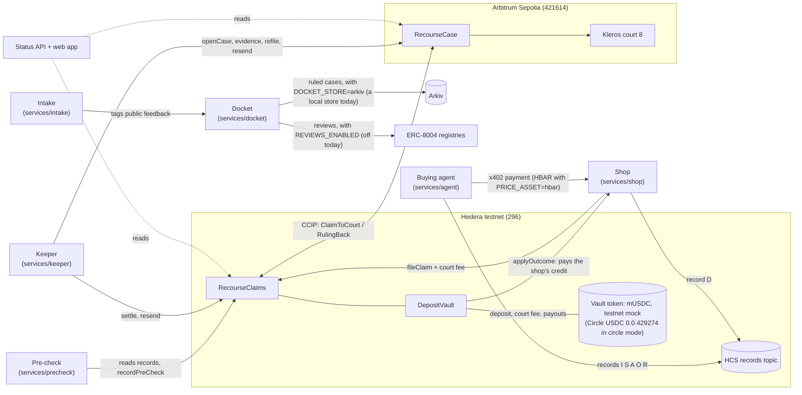
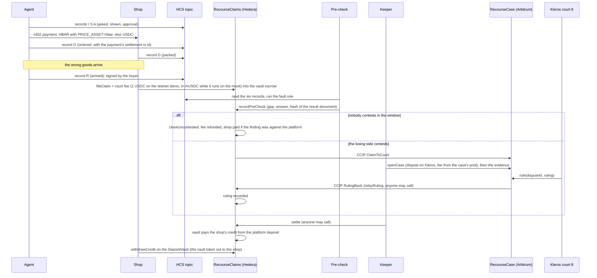

# Recourse

Recourse lets a shop recover money when an AI shopping agent buys the wrong thing.

An agent pays a shop over x402 (an HTTP payment protocol: the shop answers `402 Payment Required` with a price, and the client pays and asks again) on Hedera. Before it pays, it commits three records to a Hedera Consensus Service (HCS) topic: what it was asked, what it showed the buyer, and the approval. After the payment settles it commits a fourth, the ordered record, which carries the payment's transaction id; the shop commits what it packed. If the wrong goods arrive, the shop files a claim on Hedera and escrows a court fee. A rule-based pre-check compares the records, names the gap and the side at fault, and the losing side may contest. A contest crosses Chainlink CCIP (Cross-Chain Interoperability Protocol) to Arbitrum Sepolia, where a Kleros court rules. The ruling crosses back, and a deposit posted by the agent company pays the shop. On the testnet demo the deposit, the court fee and any payout are in mUSDC, a mock USDC token deployed for the demo, because Circle's testnet USDC faucet did not deliver. A docket service counts ruled cases per agent company and shop, for fault rates; it can publish them on Arkiv, but the running docket keeps them in a store on its own host, and nothing has been written to Arkiv yet.

Built at ETHGlobal Mumbai, 5-7 Nov 2026. Testnets only. All shop and agent-company names are fictional.

> **Status, 6 Nov 2026: running on testnets, configuration not locked.** The contracts are deployed on Hedera testnet and Arbitrum Sepolia and the services run on one host. Two claims have run to the end: one closed uncontested, and one was contested, ruled 3 ("neither side at fault") by Kleros court 8 (dispute 212), sent back to Hedera over CCIP and settled there on 6 Nov at 11:10 UTC. Both found nobody at fault, so no shop has yet been paid from a deposit. <!-- BUILD: payout case: one sentence and a link to its row in "Deployed addresses and transactions" once the shop has been paid from the deposit and has withdrawn. --> None of the three contracts is locked yet, so the deployer key can still change every setting, including ones that decide claims ([owner powers](#owner-powers-and-spend-paths)). See [What is live and what is not](#what-is-live-and-what-is-not).

## Contents

1. [Architecture](#architecture)
2. [One claim, end to end](#one-claim-end-to-end)
3. [How each technology is used](#how-each-technology-is-used)
4. [Repository layout](#repository-layout)
5. [Setup and tests](#setup-and-tests) (full guide: [docs/setup.md](docs/setup.md))
6. [Open-source libraries](#open-source-libraries)
7. [Owner powers and spend paths](#owner-powers-and-spend-paths)
8. [What is live and what is not](#what-is-live-and-what-is-not)
9. [Deployed addresses and transactions](#deployed-addresses-and-transactions)
10. [Known limits](#known-limits)
11. [Disclosures](#disclosures)

## Architecture



The two chains never share state. Everything either side needs from the other travels as a CCIP message of fixed layout ([interfaces](docs/spec/interfaces.md), section 8), and every receive path decodes defensively: a bad message is ignored with an event and never reverts, so one bad message cannot block a lane.

## One claim, end to end



1. **Records.** Six records per order, one HCS message each ([interfaces](docs/spec/interfaces.md), section 2): asked (I), shown (S), approval (A), ordered (O), packed (D), arrived (R). The agent writes asked, shown and approval before it pays and ordered after the payment settles (`services/agent/src/buy.ts`); the shop writes packed; the agent writes arrived, signed by the buyer. Each message holds the IPFS CID (content identifier) of a canonical document and its SHA-256. A record counts only if the HCS message payer is a known writer for that kind.
2. **Pre-check.** The fault rule is a fixed 12-step comparison over the six attributes (brand, size, colour, quantity, price, merchant): what was asked against what was shown, whether a change was approved, and what was shown against what was ordered, packed and received. It is a pure function in `packages/shared`; the pre-check service runs it, pins the result document and signs the finding. The hashes are public; anyone can check a document against them (the claim page's "Check a record" box hashes pasted text in the browser). The documents themselves are not on public IPFS yet: they sit in a content store on the demo host, and the status API serves them with each order's records. For a claim taken to court, the keeper also posts each record document the pre-check used, in full, as Kleros evidence on Arbitrum Sepolia, where anyone can read it (see [Disclosures](#disclosures)). The web app's "Check or file an order" page (`#/file`) re-runs the rule in the browser, on the records that API serves.
3. **Contest.** The finding names a side. If the finding is against the platform, the platform contests; otherwise the shop. The window is closed at the end of the contest period.
4. **Court.** A contested claim goes to Arbitrum by CCIP. `RecourseCase` opens a Kleros dispute in court 8, with a three-way answer (agent company at fault, shop at fault, neither) and a published policy, and the keeper posts the evidence. The court's ruling comes back as a second CCIP message.
5. **Refused ruling.** A ruling of 0 (refused) is refiled once. A second 0 counts as a ruling equal to the pre-check answer.
6. **Payout.** The settlement table is in [interfaces](docs/spec/interfaces.md), section 10. In short: the loser pays the court fee; if the platform is at fault the shop gets its net loss plus a handling amount from the platform's deposit; if the shop is at fault it gets nothing and the fee stays with the pool. A claim that never reaches a ruling can be expired after a timeout, with the fee refunded.

## How each technology is used

| Technology | What it does here | Where in the code |
|---|---|---|
| **Hedera x402 payments** | The agent pays the shop with the x402 `exact` scheme on `hedera:testnet`. On the testnet demo orders are priced and paid in HBAR, 1 HBAR per 1 USDC of list price, when `PRICE_ASSET=hbar`; unset or `usdc`, they are paid in USDC `0.0.429274`. Set it in the shared `~/.config/recourse/recourse.env`, which the shop unit, the agent commands and `ops/fund` all read, not in `shop.env`: a shop asking for HBAR from an agent that expects USDC is refused as `wrong_asset`. The agent reads the price and `payTo` from the shop's 402 response; below its spend limit it pays without a human, above it a buyer approval is needed. The spend limits are in USDC, and an HBAR amount is converted at that rate before it is compared. A public facilitator is tried first, then a second public one, then a self-hosted one. The settlement transaction id goes into the "ordered" record. | `services/shop`, `services/agent` |
| **Hedera Consensus Service** | One records topic holds the six records of every order. The pre-check and the court evidence read the topic through the mirror node and accept only messages from the right payer. | `packages/records`, `services/precheck` |
| **HTS USDC, or the testnet mock** | The platform deposit, the court-fee escrow and the shop's payout are all in the vault's token, which `deployments/hedera.json` records as `usdc.mode`; every reader takes it from that record, so one deployment never mixes tokens. In `circle` mode it is Circle's testnet USDC `0.0.429274`, used through its ERC-20 facade: the vault associates the token explicitly after deploy, and nothing moves before the mirror node shows the association. The current deployment is in `mock` mode, because Circle's faucet did not deliver: the token is `mUSDC`, a plain 6-decimal ERC-20 minted by the deployer, with no HTS token id and no mirror row, so the checks are `Vault.usdcAssociated()` and `Vault.usdc()` equal to the recorded address. With `PRICE_ASSET=hbar` the x402 order payments are in HBAR. | `contracts/src/hedera`, `contracts/script/hedera`, `contracts/src/testnet/MockUsdc.sol`, `packages/shared/src/vaultToken.ts`, `ops/lib/vault-token.sh` |
| **Chainlink CCIP, both ways** | `RecourseClaims` sends `ClaimToCourt` to `RecourseCase`; `RecourseCase` sends `RulingBack`. Each contract is its own receiver and sender, with V2 extra args, out-of-order execution on and full finality. Fees are paid in LINK (or HBAR on the Hedera side). Resend is open to anyone, capped in count and spacing, so a lost message costs a bounded amount of LINK. | `contracts/src/hedera/RecourseClaims.sol`, `contracts/src/arbitrum/RecourseCase.sol`, `contracts/src/shared` |
| **Kleros court on Arbitrum Sepolia** | `RecourseCase` creates the dispute on the live KlerosCore in court 8 (testnet), registers the dispute template, and receives the ruling through `rule`. The keeper pays the arbitration cost from the case's fee pool and posts the evidence. | `contracts/src/arbitrum`, `packages/court`, `services/keeper` |
| **Arkiv docket** | The docket service turns each ruled claim into one de-identified `case` row and keeps a monthly count per agent company and shop. With `DOCKET_STORE=arkiv` it writes them as Arkiv entities from one writer wallet; the running docket leaves `DOCKET_STORE` unset, so it keeps them in a local store in its own state folder (`local-store.jsonl`), and no entity has been written to the Arkiv testnet. The docket page reads Arkiv in the browser and computes fault rates (Wilson 95% interval) there; while the docket's store is local, the page says so and shows no rates. | `services/docket`, `arkiv/`, `apps/web/src/pages/Docket.tsx` |
| **ERC-8004 identity and reviews** | ERC-8004 is a set of on-chain registries for AI agents: identity, reputation and validation. The platform (the agent company) and the shop are registered in the identity registry, and the agent finds the shop's x402 endpoint from its registration (`SHOP_BASE_URL` is used only when that lookup fails, `services/agent/src/setup.ts`). With `REVIEWS_ENABLED` set, the docket's scheme wallet leaves a review in the reputation registry after each case it writes; it is off on the running docket, so no review has been written. A self-review is rejected by the registry, which is why the reviewer is a separate wallet. | `packages/shared/src/abi/erc8004.ts`, `services/docket/src/reviews.ts` |

Other parts: a status API and web app (case status, filing, docket), and an intake service whose only job is to tag public feedback text with an LLM. **No model decides money at any point at runtime.** Money moves only by the contracts' rules.

## Repository layout

| Path | What |
|---|---|
| `contracts/` | Foundry project: Hedera `RecourseClaims` and `DepositVault`, Arbitrum `RecourseCase`, shared types and codecs, CCIP ping contracts, deploy and wire scripts |
| `packages/shared` | Types, ids, hashing, codecs, the fault rule, status keys, address book, test vectors |
| `packages/court` | Kleros dispute template, court policy, evidence builder |
| `packages/records` | HCS record commits and reads, IPFS pinning |
| `packages/renderer` | The approval screen renderer |
| `services/shop`, `services/agent` | x402 seller and buyer |
| `services/precheck`, `services/keeper` | Fault rule runner; the machine that moves a claim between the chains |
| `services/docket`, `services/intake` | Arkiv publisher and ERC-8004 reviews; feedback tagger |
| `services/status-api`, `apps/web` | Read API and the web app |
| `arkiv/` | Arkiv usage notes: schema, query, friction, reach |
| `deployments/` | Addresses, ABIs and the wiring record per chain |
| `ops/` | Funding, wiring, service units, checks and the secret scan; `ops/workflows/` holds each area's AI-use notes |
| `docs/` | `spec/interfaces.md` (the contract between the parts), `setup.md`, `runbook.md`, `decisions.md`, `checks.md`, `keys.md`, `ai-use.md` |

## Setup and tests

The full instructions, the settings by name and the testnet procedure are in [docs/setup.md](docs/setup.md).

Needs Node.js 22.12 or newer (`engines` in `package.json`), pnpm 12.8.1 (`packageManager` in `package.json`; `corepack enable` provides it), Foundry (`forge`, `cast`, `anvil`; the contracts pin solc 0.8.37 in `contracts/foundry.toml`), and bash, `jq`, `python3` and `flock` for the scripts. Close other heavy processes first; the tests run one package at a time and use a few hundred MB.

```
corepack enable
pnpm install --frozen-lockfile
pnpm typecheck                              # every package, one at a time
pnpm test                                   # TypeScript tests, one package at a time
pnpm --filter @recourse/keeper test         # or a single package
pnpm --filter @recourse/web build           # the web app; the services run through tsx and have no build step
cd contracts && forge build && forge test --jobs 1   # Solidity unit, fuzz and invariant tests
```

Local runs, with nothing on a public network:

```
pnpm --filter @recourse/agent local-demo                 # one whole order on this machine, from the records to a filed claim
pnpm --filter ./services/keeper test:anvil               # the keeper on two anvils with a local CCIP relay
bash contracts/script/hedera/hedera.sh rehearse <port>   # Hedera deploy-to-lock on one anvil
bash ops/wire/rehearse.sh                                # both deploys and every wiring step on two anvils
bash ops/units/install.sh --verify                       # validates the service unit files
```

The local runs use a mock USDC, a mock arbitrator and the CCIP local simulator; `local-demo` also uses an in-memory HCS topic and a simulated facilitator, so no money moves. They write only `*.local.json` files, which are git-ignored.

On the testnets: settings go in `~/.config/recourse/recourse.env` (the shared names in [.env.example](.env.example), the rest in [docs/setup.md](docs/setup.md#settings); values never in git) and each role's key in its own Foundry keystore ([docs/keys.md](docs/keys.md)). The contracts are deployed and wired by `contracts/script/hedera/hedera.sh`, `contracts/script/arbitrum/deploy.sh` and the steps in `ops/wire/`, each a dry run until given `--broadcast` or `--send`, and the services run as systemd user units (`bash ops/units/install.sh --install`, then `bash ops/units/ctl.sh start`; see [docs/runbook.md](docs/runbook.md)). Every service reads the contract addresses from `deployments/hedera.json` and `deployments/arbitrum.json`.

## Open-source libraries

Read from the `package.json` files and `contracts/remappings.txt`; the versions are the pinned ones.

| Library | Version | Licence | Used for |
|---|---|---|---|
| viem | 2.57.8 | MIT | every contract read and write from TypeScript, on both chains |
| @hiero-ledger/sdk (the Hedera SDK) | 2.85.0 | Apache-2.0 | HCS record messages, Hedera transaction signing, the shop's self-hosted facilitator |
| @x402/core, @x402/hedera, @x402/express, @x402/fetch | 2.28.0 | Apache-2.0 | x402 `exact` payments on `hedera:testnet`: the shop's paid endpoint and the agent's paying client |
| @kleros/kleros-sdk | 2.4.0 | MIT | checking the Kleros dispute template (`packages/court`) |
| @kleros/kleros-v2-contracts | 0.12.0 | MIT | the arbitrator, arbitrable and evidence interfaces `RecourseCase` uses |
| @chainlink/contracts-ccip | 2.0.0 | BUSL-1.1 for the package; the three files imported (`Client.sol`, `IRouterClient.sol`, `CCIPReceiver.sol`) are MIT | CCIP send and receive in `RecourseClaims` and `RecourseCase` |
| @chainlink/local | 0.3.1 | MIT for the package; its `CCIPLocalSimulator.sol` is BUSL-1.1 and `LinkToken.sol` is UNLICENSED | the CCIP local simulator, in Solidity tests only |
| @chainlink/contracts | 1.5.0 | BUSL-1.1 | only through @chainlink/local, in tests |
| @chainlink/ccip-cli | 1.16.1 | MIT | declared as a dev tool; no script uses it |
| @openzeppelin/contracts | 5.6.1, plus 5.3.0 and 4.8.3 for the Chainlink packages | MIT | ownership, safe ERC-20 calls, reentrancy guards, the mock token |
| forge-std | 1.17.0 | MIT OR Apache-2.0 | Solidity tests and scripts |
| @arkiv-network/sdk | 1.0.1 | MIT (its `LICENSE.md`; its `package.json` names none) | the docket's Arkiv store and the web app's Arkiv reads |
| @aws-sdk/client-s3 | 3.1155.0 | Apache-2.0 | Filebase pinning through its S3-compatible API (not configured on the demo) |
| @ipld/car, multiformats | 5.4.7, 14.0.5 | Apache-2.0 OR MIT | CIDs and CAR packing for record documents |
| express | 5.3.0 | MIT | the services' HTTP servers |
| zod | 3.25.76 | MIT | the shop's order validation |
| react, react-dom | 19.3.1 | MIT | the web app |
| vite, @vitejs/plugin-react | 8.3.5, 6.1.2 | MIT | the web app's build and dev server |
| vitest | 5.0.5 | MIT | TypeScript tests |
| typescript | 7.0.2 | Apache-2.0 | type checking |
| tsx | 4.23.15 | MIT | runs the TypeScript services and scripts without a build step |

The `@types/*` packages (MIT) supply type definitions only.

## Owner powers and spend paths

The deployer key owns all three contracts (two-step ownership transfer only). Each contract has a one-way `lockConfig`; the tables show what is possible before and after it. After the lock the owner can configure only the settings marked "yes" in the right-hand column, and none of them decides a claim. **Before the lock it can decide claims**: on `RecourseClaims` it can make itself the pre-check signer (`setPreCheckSigner`) and sign any finding, switch to a one-leg bridge mode with itself as the ruling relayer (`setBridgeMode`) and record any ruling, or point `setPeer` at a contract it controls and send a ruling back over CCIP; `settle`, which anyone may call, then pays from the platform's deposit. On 6 Nov 2026 none of the three contracts is locked (`configLocked()` and `locked()` read false), and the deployer keystore sits on the host that runs the services, including the two reached through public tunnels ([ops/units/README.md](ops/units/README.md#what-a-unit-can-see)). Until the lock, treat every claim as decided at the deployer's discretion.

### `RecourseClaims` (Hedera)

| Power | Before lock | After lock |
|---|---|---|
| `setPeer` (the court contract), `setParams`, `setPreCheckSigner`, `setBridgeMode` (and the relayer) | yes | no |
| `sweepLink`, `sweepNative` (move this contract's LINK or HBAR out) | yes | no |
| `setExtraArgs` (CCIP gas for later sends) | yes | yes |
| `setFeeToken` (LINK or HBAR for CCIP fees) | yes | yes |
| `lockConfig` | once | |

The owner cannot change a finding or ruling once it is recorded, file a claim for a shop, or move the vault's USDC itself; before the lock it can still choose who records the findings and rulings of claims not yet decided, as above. Trusted roles: the **pre-check signer** is the one trusted step (it signs the finding; the record hashes are public, so anyone can check a document against them and re-run the rule on documents that match, and a wrong finding can be contested). The **ruling relayer** can record rulings only in the one-leg modes; in the default two-way mode that call is refused, and only the owner can change the mode, before the lock.

Spend paths: LINK or HBAR leaves for CCIP fees only, through `sendToCourt` and `resend` (permissionless, at most `maxSends` per claim and `resendGap` apart), and through `sweepLink` and `sweepNative` before the lock. No function accepts USDC.

### `DepositVault` (Hedera)

| Power | Before lock | After lock |
|---|---|---|
| `bindClaims`, `setParams` (top-up window, exit delay, minimum deposit) | yes | no |
| `setRequired(platform, amount)` (the deposit a platform must hold to be in good standing) | yes | yes |
| `lockConfig` | once | |

Spend paths: USDC leaves the vault only by `applyOutcome` (callable only by Claims, from its settle and close paths), by `withdrawCredit` (the shop or pool collecting its own credit), and by a platform's own `exit` after `requestExit` plus the exit delay, with no open claims. The owner cannot withdraw. `setRequired` can raise a platform's requirement, which can put it out of good standing and stop shops accepting its orders, so it is disclosed here as a live owner power.

### `RecourseCase` (Arbitrum Sepolia)

| Power | Before lock | After lock |
|---|---|---|
| `setPeer` (the Hedera claims contract), `setParams` (case deadline, open-case cap, resend gap, max sends), `setTrustedRelay` | yes | no |
| `sweepLink` | yes | no |
| `setExtraArgs` (CCIP gas for rulings; must be non-zero), `setPolicyURI` (must be an `/ipfs/` path), `setTemplateText` | yes | yes |
| `withdrawFeePool` (the team's arbitration money) | yes | yes |
| `lockConfig` | once | |

The owner cannot change or invent a ruling (only KlerosCore calls `rule`), cannot open a case without a stored claim, and cannot take ETH except through `withdrawFeePool`. `setTrustedRelay` is off by default; when set, that one address may submit a claim without CCIP, a disclosed trusted step. The template and policy changes affect only later cases.

Spend paths: ETH leaves through `openCase` and `refile` (exactly the live Kleros arbitration cost, at most two disputes per claim) and `withdrawFeePool` (owner only); ETH attached to `relayRuling` pays exactly the CCIP fee and the surplus goes back to the caller, or into the pool if the caller cannot take it. LINK leaves through `relayRuling` (permissionless, exactly the quoted fee, at most five sends per claim, 30 minutes apart, so the worst LINK loss per claim is five fees) and `sweepLink` before the lock. Plain ETH sends revert. `maxOpenCases` caps open disputes, and because opening and resending are permissionless, third parties can fill that cap.

### Keys

Ten roles, each with its own Foundry keystore kept outside the repo ([docs/keys.md](docs/keys.md) lists names and public addresses, never values). The deployer owns the contracts; `ops-hedera` and `ops-arb` run the keeper and top-ups; the others are service identities.

## What is live and what is not

| Part | State |
|---|---|
| Solidity contracts (Claims, Vault, Case) | Written. Unit, fuzz and invariant tests pass locally. DepositVault (`0.0.11336129`) and RecourseClaims (`0.0.11336130`) are deployed on Hedera testnet on a testnet mock USDC (`mUSDC`), because Circle's testnet USDC faucet did not deliver; config not locked yet; see `deployments/hedera.json` (`usdc.mode` is `mock`, with the mock's address). The first deployment (`0.0.11329716`, `0.0.11329717`, on Circle USDC `0.0.429274`) is retired and listed in `deployments/retired.json`. RecourseCase (`0xd7f11FA06A97a45a6Af03c71d7eB3219C1a703B8`) is deployed on Arbitrum Sepolia; see `deployments/arbitrum.json`. |
| Deploy and wiring scripts | Written and rehearsed on local anvils. The Hedera deploy, USDC association and parameter steps have run on testnet, and so has the Arbitrum deploy. `deployments/wiring.json` lists the wiring steps run through the scripts; its first Hedera rows were sent to the retired claims contract and are marked `retired`. The replacement claims contract was wired outside the scripts (its peer, its LINK, and RecourseCase repointed to it in `0x0bf1a1f62c9a62066128d31de5a26e637b2616044d4c93ddee6b5bc3d4ad1e8f`, see `deployments/retired.json`). |
| TypeScript services (shop, pre-check, keeper, docket, intake, status API) | Running on one host against Hedera testnet and Arbitrum Sepolia, as systemd user units ([ops/units/README.md](ops/units/README.md)). The buying agent has no long-running service; it places one order per run from the command line. |
| Web app | Built and served from the same host by `recourse-web`, reached through a Cloudflare quick tunnel. A quick tunnel's name changes on every restart, so no URL is pinned here; `bash ops/units/ctl.sh urls` prints the current one. |
| Orders and claims | Four x402 payments had settled on Hedera testnet in HBAR through the x402.org facilitator by 18:30 UTC on 6 Nov (listed below). The second and third paid for two demo orders, which the shop then claimed against; the fourth (17:20 UTC) paid for a third demo order, whose buyer has complained and against which no claim has been filed yet. On the first claim the pre-check answered 3 ("neither": the agent's mandate had approved the size change the claim was about), nobody contested within the window, and the keeper closed the claim; the 1 mUSDC court fee went back to the shop as credit. A second claim (`0x392d6f13…7c3c50`, on the second demo order, paid by the third payment) was also pre-checked 3; the shop contested it, it went to Arbitrum over CCIP and became Kleros dispute 212, and the court ruled 3 ("neither"). The ruling came back over CCIP and the keeper settled the claim on Hedera on 6 Nov at 11:10 UTC: nothing was owed, and the shop's 1 mUSDC court fee was kept by the pool. The first claim's 1 mUSDC credit was withdrawn by the shop. |
| Funding | Small. The Hedera roles hold a few HBAR each from the faucet (at most 10 HBAR per address). On Arbitrum Sepolia the deployer and `ops-arb` hold test ETH and RecourseCase's fee pool, funded with 0.01 ETH for Kleros fees, held 0.00919 ETH after dispute 212; RecourseCase holds no LINK, so the keeper pays the ruling's CCIP fee in ETH from `ops-arb`. The claims contract holds test LINK for CCIP fees (`ops/wire/12-set-fee-token.sh` switches it between LINK and HBAR). Circle testnet USDC was requested for the platform, shop and agent and never arrived; the vault's `mUSDC` is minted by the deployer, the mock's owner. With orders paid in HBAR (`PRICE_ASSET=hbar`) the agent needs no USDC; its HBAR floor is then 8 (`ops/fund/lib.sh`). |
| CCIP lanes | Public lanes exist on both testnets and the peers are set both ways. Two messages so far, both for claim `0x392d…` and both executed: `ClaimToCourt` to Arbitrum (sent 09:07 UTC on 6 Nov, executed within a minute) and `RulingBack` to Hedera (sent 10:51 UTC, executed 11:10 UTC). |
| Kleros dispute | Dispute 212 in court 8, opened by RecourseCase on 6 Nov at 09:08 UTC with the order records as evidence, ruled 3 ("neither") at 10:43 UTC, and executed at 10:51 UTC. |
| Arkiv docket | The docket runs on its local store (`DOCKET_STORE` unset): it holds the ruled case of dispute 212 and that month's count there, and no entity has been written to the Arkiv testnet. |
| ERC-8004 identities | Registered in the identity registry `0x8004A818BFB912233c491871b3d84c89A494BD9e` on Hedera testnet: agent 149 is the platform ("Parcel Minds"), agent 150 the shop ("Halden Supply"). No review has been written: reviews are off on the running docket (`REVIEWS_ENABLED` defaults to off). |
| Source verification | Not done for any contract yet. |
| Hedera testnet upgrade | Fri 6 Nov 2026, 17:50-18:55 UTC: Hedera testnet is paused; no Hedera sends are planned in that window. |

<!-- BUILD: redeployed contracts: update the "Solidity contracts" row above (new Hedera ids and addresses, lock state) and the "Source verification" row (verified on HashScan and Arbiscan, with links). -->
<!-- BUILD: remove or update the "Hedera testnet upgrade" row once the upgrade is over. -->

What is mocked in tests and local runs, which deploy their own mocks: HTS and the PRNG system contract, the USDC token, the CCIP router (a local simulator with a relay that can drop and delay), and KlerosCore (a mock arbitrator that accepts a chosen ruling). One mock is live: the testnet demo's current Hedera deployment runs on a testnet mock USDC (`mUSDC`, "Mock USD Coin (testnet)", 6 decimals, minted only by its owner) because Circle's testnet USDC faucet did not deliver to our accounts. It is not Circle's token and is worth nothing; the status API and the web app label its amounts "mUSDC (testnet mock)". The first deployment, on Circle USDC, is retired and listed in `deployments/retired.json`. Order payments (x402) are in HBAR and never touch the vault token. Nothing in this repository fabricates a ruling, a payment or a transaction hash for display.

## Deployed addresses and transactions

Taken from `deployments/`, `deployments/wiring.json`, `packages/records/h0-ids.json`, the Hedera mirror node and the status API's chain reads (`GET /claims/<id>`). All testnet.

| Item | Chain | Address or id | Transaction | Explorer | Source verification |
|---|---|---|---|---|---|
| `DepositVault` | Hedera testnet | `0.0.11336129` (`0xA22fB188b49eddecc4f9DE22607e70E1d07Aea2e`) | `0x05923a8a3abcf2988ff7b1c3ea29bfedcf0f8c6df18a71e23b314c4f26bce11d` | [HashScan](https://hashscan.io/testnet/contract/0.0.11336129) | not verified |
| `RecourseClaims` | Hedera testnet | `0.0.11336130` (`0xc4d457991eE42438EA433773e491ba8F2B27dDee`) | `0x1196cbc22c60db8cfe6443ba51bae809a4a8c7e106545e739071ea3f488a1d53` | [HashScan](https://hashscan.io/testnet/contract/0.0.11336130) | not verified |
| `MockUsdc` (`mUSDC`, the vault token) | Hedera testnet | `0x6D6fb82e82E525B9c30619189EA8aF17117C3c73` | `0x14005c3a5027eb101c99528d990ee1b2ff6d53f6de60a3aee196fe34cb6801e0` | [HashScan](https://hashscan.io/testnet/contract/0x6D6fb82e82E525B9c30619189EA8aF17117C3c73) | not verified |
| `RecourseCase` | Arbitrum Sepolia | `0xd7f11FA06A97a45a6Af03c71d7eB3219C1a703B8` | `0x21695fedbc3d8d91c15c651eb8ae8ed747adf356182038b437b64633b00e6492` | [Arbiscan](https://sepolia.arbiscan.io/address/0xd7f11FA06A97a45a6Af03c71d7eB3219C1a703B8) | not verified |
| HCS records topic | Hedera testnet | `0.0.11335218` | `0.0.11329551@1793945456.221613303` | [HashScan](https://hashscan.io/testnet/topic/0.0.11335218) | n/a |
| ERC-8004 agents 149 (platform), 150 (shop) | Hedera testnet | registry `0x8004A818BFB912233c491871b3d84c89A494BD9e` | `0xea5d875c0d3ac84055636ee4f082a8bfe3acb495885e5baf32f2e8ef8c5eaa64`, `0xd7e03c68f1240111c45d7af8d5a581614ce234a3a0a29ae93c8b91bc7ae5314a` | [HashScan](https://hashscan.io/testnet/contract/0x8004A818BFB912233c491871b3d84c89A494BD9e) | n/a |
| First settled x402 payment (0.1 HBAR, agent `0.0.11329682` to shop `0.0.11329680`) | Hedera testnet | n/a | `0.0.9185802@1793949477.114377745` | [HashScan](https://hashscan.io/testnet/transaction/1793949483.409917104) | n/a |
| First demo order payment (1.5 HBAR, same accounts) | Hedera testnet | order `0x1bf80d52b5b114f4318d40259c3bc2990db86f8e82a5101abafb337f4f3ad802` | `0.0.9185802@1793954349.706075765` | [HashScan](https://hashscan.io/testnet/transaction/1793954357.635329575) | n/a |
| Second demo order payment (1.5 HBAR, same accounts; the order of the claim taken to court) | Hedera testnet | order `0xb7da5ace588084b3bfb85062d4f17f18137e5572917158432b14df0f9ed8c428` | `0.0.9185802@1793955935.573660355` | [HashScan](https://hashscan.io/testnet/transaction/1793955942.069785771) | n/a |
| Third demo order payment (1.5 HBAR, same accounts, 17:20 UTC; complained, no claim filed yet) | Hedera testnet | order `0x6d94a648b3baecd5497adb542dcaaed82aa007d92c2b891acec0608d1a769274` | `0.0.9185802@1793985607.160449829` | [HashScan](https://hashscan.io/testnet/transaction/1793985622.013190058) | n/a |
| First claim: filed, pre-checked, closed uncontested | Hedera testnet | claim `0x9cd704684c56a0ba1ff17ba9765d7c1e8521e78a3d0a4bbe7935d5a2a87e412c` | `0x8b1c0ace74283adc097c8f557b4adffaac2dcab530467d58b92a50612297c789`, `0x2c8d558a26cd071e74cac125179fc51b592c83f9bd3af96db2a7bf69b37a1deb`, `0x243c3b5403d70a87dc78713ab337e97386c2ea37683fcb87245b68d58f3e9665` | [HashScan](https://hashscan.io/testnet/contract/0.0.11336130) | n/a |
| First claim taken to court: filed, pre-checked, contested, sent | Hedera testnet | claim `0x392d6f13cdf5fe1ca93289d143e51b511f333de3d6d1769c72ddd0039c7f3c50` | `0xb0486c1e1cec26ef8910dceb092888e00ad2f798590531f36fe56ceb99679776`, `0x22454f7e9df75d5052a39a8c7cfa0a74c3696ebaf9f6e75d6adcd40621990810`, `0xd4b1351daa9bf82b3bc6bf086b80e7117e7e84cda66ea20e1db3d33f6453fec3`, `0xcf5236a69f8c8a0d8c4d537993692e41bdd4194ba2b2027eaea0037bebe933c4` | [HashScan](https://hashscan.io/testnet/contract/0.0.11336130) | n/a |
| First CCIP message to Arbitrum (`ClaimToCourt`) | Hedera to Arbitrum Sepolia | message `0x6631dc70a8a954c4e442cb8104af8d5c45b2117724d6deea096e9a8d6bc60adc` | sent in `0xcf5236a6…e933c4`, received in `0x27555711edfb76427d17b791aec8bc25c6ab7e70a33e19588aa9e662da3bd7db` | [CCIP Explorer](https://ccip.chain.link/msg/0x6631dc70a8a954c4e442cb8104af8d5c45b2117724d6deea096e9a8d6bc60adc) | n/a |
| First Kleros case | Arbitrum Sepolia | dispute 212, court 8 (template 194) | opened `0x993c49af2b77ed0710c5e3f5d17efc9789e80333a488ca3f894058ae6eb83a42`, evidence `0x6c97c6c8ff46997e118d7531410861324bc6f98dc92c3f01fb4223abdf4f9959`, ruling executed `0xeebfe2fea6267ecc3acbdc30a6ab74981ed653b4efba12c0abae86f06e41d417` | [Kleros](https://v2-testnet.kleros.builders/#/cases/212/overview) | n/a |
| First CCIP message to Hedera (`RulingBack`) | Arbitrum Sepolia to Hedera | message `0xbc0bb5f319c9045d70576b7a906c84b149a10c6de6638eda8eb4148e29d52ff3` | sent in `0x6d471236aac5149728e96e977fc492ff2b5536fefeb8c545bf121e29a8f13c0d` (fee in ETH), received in `0x33363440caab6fe0719e806d4bf2ce132673208d7e3280ca4d426d96dc3f15c3` | [CCIP Explorer](https://ccip.chain.link/msg/0xbc0bb5f319c9045d70576b7a906c84b149a10c6de6638eda8eb4148e29d52ff3) | n/a |
| First court case settled: ruling 3 applied, nothing owed, court fee kept by the pool | Hedera testnet | claim `0x392d6f13cdf5fe1ca93289d143e51b511f333de3d6d1769c72ddd0039c7f3c50` | `0x502db49f52f56bb2e1f014277139ccf140344186e6a5f257a9c59d7b9d90bd40` | [HashScan](https://hashscan.io/testnet/contract/0.0.11336130) | n/a |
| First credit withdrawn (claim `0x9cd7…412c`'s 1 mUSDC, to the shop) | Hedera testnet | vault `0.0.11336129` | `0x082d0148c6773a8c6f0b4e62db4a9cb28d88e6d41285380728a428cb3b57f050` | [HashScan](https://hashscan.io/testnet/contract/0.0.11336129) | n/a |
| Arkiv writer wallet | Arkiv testnet | `0x54E4545AFcf8960884A750320e70aFE16b2b3CaE` (address only, no entity written yet) | n/a | n/a | n/a |

<!-- BUILD: payout case: add its rows inside the table above (x402 payment, the six records, fileClaim, recordPreCheck, closeUncontested or settle, withdrawCredit), each with its hash and explorer link. If the payout case is order 0x6d94a648…, its payment row is already there: reword that row and the "Orders and claims" row above, which say no claim has been filed for it yet. -->
<!-- BUILD: redeployed contracts: add the new DepositVault, RecourseClaims, MockUsdc and RecourseCase rows inside the table above (address, deploy tx, explorer), keep the old rows marked retired, and fill the "Source verification" column with the HashScan and Arbiscan verification links. -->
<!-- BUILD: the two test runs side by side: add a "### Test runs on testnet" heading here and one table with a column per run (the same command against the old and the redeployed contracts: command, order id, claim id, each step's tx hash, result). -->

## Known limits

A code review of commit `f05649d` (6 Nov 2026, by four AI models, with every finding then checked against the code) confirmed 157 findings. Each has a review finding id, R01 to R157, and a severity: P0 loses or locks funds or forges a ruling, P1 gives a wrong outcome or breaks a flow, P2 is a robustness gap, P3 is minor. There was no P0. When the findings were checked against the code again at about 15:00 UTC that day, 112 P2 and P3 findings were still present or only partly fixed (38 P2, 74 P3).

The 10 P1 findings are not in the tables below. Five (R04, R07, R08, R09, R10) were already fixed in the source at that check, and four have had fixes committed since: R02 (`485316d`), R03 and R05 (`5e58081`) and R06 (`4109ef4`). R04 (`ece7d36`) is a contract change, so the deployed vault takes it only with the redeploy; until then, a platform whose exit is due still reads as in good standing while every new claim against it reverts. R01 stays as an accepted limit, recorded in `docs/decisions.md` (`4b46366`): each court case has a cut-off on Arbitrum that falls before Hedera can expire its claim; a case that runs past it (for example on appeal) has its ruling dropped and its arbitration fee lost, and the shop gets back only its court fee. In the current source that cut-off is 2 h before Hedera's, which leaves time to relay a ruling (`f294d80`); the deployed `RecourseCase` predates it and takes it only with the redeploy.

Since that check, 33 of the 112 P2 and P3 findings have had fixes committed, each commit naming the finding or describing its fix (a reader can check each one): R13 (`873f6d3`, `fdf4b43`), R14 (`9fe5855`), R21 (`873f6d3`), R22 (`5e58081`), R26 (`bb5f16c`), R28 (`5a35970`), R29 (`5719e73`, `bc0175e`), R30 (`cb3b065`, `6e9f5c3`), R31 (`de695b3`), R32 (`46444f3`), R38 (`5e58081`, `e36767c`), R43 (`9fb4f9b`, `1068b29`), R47 (`108adcf`), R51 (`56fd0f6`), R53 (`109d794`), R56 (`5e58081`, `e36767c`), R57 (`873f6d3`), R58 (`5843978`), and later the same day R11 and R73 (`ec9739b`: the status API marks a failed live or parameter read as `degraded` and gives its age), R24, R25, R39 and R42 (`6f191f8`: the shop needs its party map to start, refuses complaints it cannot check, reads the payer from the payment, and checks the order again after the standing read), R27 (`3775bb1`: the approval renderer refuses a value it would not show as given) and R61 (`42eab83`: a failure at verify counts toward the move to the backup facilitator), and in the evening seven status API findings: R20 and R54 (`eaa8b20`: the saved index records the deployment and records topic it was read from, and a restart during the first full read still answers "rebuilding"), R36 (`0896ecf`: right after a resend, the older message no longer marks a claim stuck), R18 (`ba0c77c`: a party's escrow is read from the vault, and a platform no longer counts its shops' court fees), R12 (`0ba62fe`: court evidence is read in chunks, and a failed read shows in `/health`), R37 (`2527a58`: a missing document's retries back off up to 30 minutes, and document fetching has a time budget per poll) and R35 (`8db98c1`: a ruling indexed after a failed case read no longer shows the case as open). R47 is a contract change, so the deployed contracts take it only with the redeploy. The tables leave those 33 out and list the other 79 (6 P2, 73 P3), grouped by part of the system, each with what can go wrong and the planned fix.

Terms used below: the *mirror node* is Hedera's public REST read API; a service's *journal* is its append-only state file, and its *cursors* record how far it has read each source; the *party map* (`deployments/parties.json`) names each party's accounts and which records each may write; the *read-back* (`ops/wire/00-readback.sh`) reads every deployed setting and compares it with the deployment files; the *lock* is each contract's one-way `lockConfig`; a *facilitator* is the x402 service that verifies and settles a payment.

<!-- BUILD: drop the rows fixed by commits after 3adb6d4 (update the counts above and in each group's summary), and add any P1 finding still open after the redeploy. -->

<details>
<summary><strong>Contracts and their deploy scripts</strong> (7)</summary>

| Id | Sev. | Limit | Plan |
|---|---|---|---|
| R48 | P2 | If the pre-check signer is down for the claim timeout (18 h), a filed claim can be expired with its fee refunded, and that order can never be claimed again. | Let a claim that expired before its pre-check be filed again, or let only the shop expire it (needs a contract redeploy). |
| R69 | P3 | Partly fixed. `hedera.sh check` passes a deployment whose signer, relayer, pool or peer is a wrong but non-zero address, for example a claims contract still pointed at the retired case contract. | Compare the signer, relayer, pool and peer with the party map and the Arbitrum deployment file. |
| R70 | P3 | With a wrong RPC URL, the CCIP ping scripts can deploy or fund a ping on the wrong network and record it as the expected chain. | Check the RPC's chain id before a ping is deployed or funded. |
| R138 | P3 | A mistyped pool, signer or relayer address is deployed as given; the pool is fixed in the vault, so a typo there needs a redeploy (the read-back catches it only after the deploy). | Compare the three addresses with the party map before deploying. |
| R139 | P3 | If the locked `gasClaimToCourt` value in the deploy parameters is ever changed from the pre-lock value, the lock will not apply it and the check script will still expect the old one. | Have the lock apply the locked value and the check read it, or drop the unused value. |
| R140 | P3 | In circle mode (Circle's USDC instead of the mock) the preflight can pass with 12-22 HBAR and the deploy is then refused by forge's own balance check (the current deployment uses mock mode). | Use the mock path's HBAR floor in circle mode too, or raise the minimum to 30 HBAR. |
| R141 | P3 | If PING_OWNER is set at deploy, ping.json records the wrong owner for the ping contract. | Record the owner read back from the deployed ping contract. |

</details>

<details>
<summary><strong>Keeper (the service that moves a claim between the two chains)</strong> (4)</summary>

| Id | Sev. | Limit | Plan |
|---|---|---|---|
| R34 | P2 | If a Kleros nudge (a public call that moves a dispute along: passPeriod, executeRuling, draw, passPhase) goes pending and later fails, the keeper never retries it. An executeRuling stuck this way holds the claim until the operator steps in. | Keep a nudge open until its transaction succeeds, and retry it when it reverts or is dropped. |
| R49 | P2 | A call that is accepted, then mines reverted, is retried forever and never counts toward the failure limits that hold the claim and alert the operator. | Count a mined revert like any other failure, so the hold and the alert apply. |
| R87 | P3 | If the keeper crashes between reading a bridge-wide event (a rejected CCIP message or an appeal contribution) and handling it, that event's alert is never raised. | Journal a marker after each such event is handled, and raise any unhandled alert on replay. |
| R88 | P3 | While the parameter read fails, the keeper keeps using the last bridge mode it read. If the mode changed before the lock during such an outage, its relay calls revert and count as failures. | Forget the mode when the read fails, and send no relay call until it is read again. |

</details>

<details>
<summary><strong>Pre-check, intake and docket services</strong> (5)</summary>

| Id | Sev. | Limit | Plan |
|---|---|---|---|
| R65 | P3 | Batch draws (a Kleros option where jurors are drawn later) are not built, so the docket's handling of a case closed before any juror was drawn is unused code. | Remove it, or wire it in when batch draws are built. No effect today. |
| R66 | P3 | Intake (the feedback tagger) answers 500 for a non-text order id, and records sent only by CID are not used unless an order id is given. | Answer 400 for a bad order id, and take the order id from a fetched document when none is given. |
| R99 | P3 | Arkiv entities expire 182 days after creation even if they were updated later, and extension is not built. | Correct `arkiv/schema.md`, or extend an entity's life when it is updated. |
| R100 | P3 | If two docket processes start at the same moment after a crash, both can run on one state directory. | Take over a stale lock through a separate exclusive file, so only one process wins. |
| R102 | P3 | Intake passes a user-supplied CID string unchecked into the gateway request and the intake pack, though the document's bytes are still verified against its hash. | Accept a reference only when its CID is the one its hash gives. |

</details>

<details>
<summary><strong>Shop and buying agent</strong> (8)</summary>

| Id | Sev. | Limit | Plan |
|---|---|---|---|
| R76 | P3 | An order in flight during a facilitator switch can fail at settle and must be paid again. | Settle on the same facilitator that verified the payment. |
| R103 | P3 | An order approved just before midnight UTC and paid after it counts toward the previous day's cap, not the new day's. | Count a payment toward the day it was signed, checked against the current day. |
| R104 | P3 | After one payment that is never confirmed, the agent gives up on the order (pay_failed) instead of paying again once that payment is dead. | Count payments actually signed rather than wait rounds, so waiting does not use up attempts. |
| R105 | P3 | When the shop refuses a payment the agent already signed, the order waits about 4 minutes before it is marked failed. | Check the payment once and end the order as soon as the signed transfer is dead. |
| R106 | P3 | If the mirror node is down while `pay-once` (a script that makes one small connectivity payment) waits on a signed payment, the script can pay the connectivity check a second time on the next facilitator. | Stop with "outcome unknown" and the transaction id instead of trying the next facilitator. |
| R107 | P3 | Re-running `pay-once` after a crash can pay the connectivity check twice. | Resolve the last signed payment in the journal before signing a new one. |
| R108 | P3 | `live-order --send` can pay for an order and write its records, then fail at filing because the shop cannot pay the court fee. | Check the shop's balance against the court fee before the order starts. |
| R109 | P3 | A rerun after the approval has expired can still post the asked, shown and approval records for an order that is then never paid. | Stop, writing nothing more, when the approval has expired and nothing was paid. |

</details>

<details>
<summary><strong>Shared packages (records, court evidence, canonical encoding)</strong> (13)</summary>

| Id | Sev. | Limit | Plan |
|---|---|---|---|
| R67 | P3 | Two commands started within a few microseconds of each other can both take the journal lock on one host. | Treat an empty or invalid process id in the lock as "not written yet" and retry. |
| R77 | P3 | Handling amounts use testnet demo values (1 USDC base, 4 USDC cap) instead of the design's 15 and 40; they are recorded only in the interfaces spec changelog. | Add a row for them to `docs/decisions.md`. |
| R78 | P3 | The local test relay can deliver a CCIP message whose sending transaction reverted at a higher level (local runs only). | Stop the local relay from delivering a message whose sending call failed. |
| R110 | P3 | A claim message the Arbitrum case rejected shows as 'At court' until the claim times out, hiding that no court case will open. | Show such a claim as stuck, with "expire the claim" once it can be expired. |
| R111 | P3 | On another host or user, the default suite lock path (`SUITE_LOCK_FILE`) points at the operator's home folder, and local deploys fail with a missing-directory error. | Build the default from the current user's home and create its folder. |
| R112 | P3 | A caller passing a sparse array would hash and pin bytes that are not JSON and that the parser rejects. | Refuse sparse arrays in the canonical encoder. |
| R113 | P3 | Without a readable party map, a service starts writing records without checking that its account is an allowed writer, so readers may ignore every record it writes. | Warn when the writer check cannot run, and fail when the named party map is missing. |
| R114 | P3 | If a party ever uses two writer accounts, a writer can commit a record whose slot readers already fill with the other account's message. | Check conflicts against the party's whole writer set from the party map. |
| R115 | P3 | A lagging or failing mirror can cause a duplicate record message with the same document; readers still use the first. | Keep polling on a mirror error, and treat only a definite miss as "never landed". |
| R117 | P3 | A party's own writer can post a zero-hash record message and then replace it with a later one, breaking first-message-wins for that slot. | Reject an all-zero hash when a record message is decoded. |
| R118 | P3 | Gateway timeouts and network errors reach callers as raw JavaScript errors, not as the module's own "fetch failed" error. | Wrap them in the module's own error. |
| R119 | P3 | `pin --verify` exits 0 even when a gateway does not serve the pinned document or serves different bytes; read the output line. | Exit non-zero when any gateway check fails. |
| R121 | P3 | A registration URL from the open ERC-8004 registry can make the service download a large body (up to the 15 s timeout) before the 64 KiB limit applies. | Refuse a large declared size up front and stop reading past 64 KiB. |

</details>

<details>
<summary><strong>Status API (the read API behind the web app)</strong> (11)</summary>

| Id | Sev. | Limit | Plan |
|---|---|---|---|
| R19 | P2 | An Arbitrum reorg deeper than 20 blocks would leave events from the dropped blocks in the index for good. | Keep recent block hashes, detect a fork, and drop the events of dropped blocks. |
| R74 | P3 | For a few seconds (about 20 Arbitrum blocks) the bridge can show a message as delivered while the case still reads as not received. | Read the message state at the same confirmed block as the other Arbitrum reads. |
| R75 | P3 | On a fresh local chain with fewer than 20 blocks, every Arbitrum contract read fails. | Clamp the confirmed block number at zero. |
| R89 | P3 | With no Hedera RPC set, deadlines and amounts come from built-in pre-lock defaults and only the /params page says so. | Flag the parameters whenever they come from the built-in defaults. |
| R90 | P3 | While a ruling is on its way back to Hedera, the court shows as ruled but the ruling and the amount owed stay blank. | Show the Arbitrum ruling in its own field until Hedera records it. |
| R91 | P3 | A finished claim whose Arbitrum case is later marked stale keeps showing the case's earlier state. | Re-read a finished claim's case at a slow pace until the case can no longer change. |
| R92 | P3 | A finished claim with an old failed send keeps getting re-read every poll, which costs RPC calls but changes nothing shown. | Treat a finished claim as done once a message in each direction has succeeded. |
| R94 | P3 | After a long Arbitrum outage, catching up runs as one long poll that delays the other sources, and a restart midway starts the catch-up over. | Cap the catch-up per poll and keep the cursor at the last block range read. |
| R95 | P3 | If the mirror's blocks endpoint is down, a lagging mirror can look up to date. | Leave the mirror's position unchanged when its head cannot be read. |
| R97 | P3 | While a shop has any credit to withdraw, every finished claim shows as waiting on it, even ones that paid nothing. | Show a claim as waiting on a withdrawal only if it credited the shop. |
| R98 | P3 | A bridge message the other chain rejected or ignored does not appear on its claim's timeline. | Map rejected and ignored messages to their claim and show them on its timeline. |

</details>

<details>
<summary><strong>Web app</strong> (16)</summary>

| Id | Sev. | Limit | Plan |
|---|---|---|---|
| R64 | P2 | There is no approval page: the buyer approves with the agent CLI and cannot check the rendered offer and its hash in the browser. | Add an approval page that re-renders the offer and checks its hash in the browser. |
| R71 | P3 | If the status API is down or rebuilding, a search for a real claim says nothing matches. | Say the search could not run, instead of showing no matches. |
| R85 | P3 | A status the web bundle does not know (API newer than the page) or a malformed reply blanks the whole site. | Show an unknown status by its raw name, and catch page errors in an error card. |
| R142 | P3 | When the vault cannot be read, the party page says no top-up is due instead of saying it is unknown. | Say "not read" when the vault could not be read. |
| R143 | P3 | An unresolved claim still waiting for settle shows its money step as 'did not happen'. | Treat the status as final only when no next call is due. |
| R144 | P3 | Between sending a claim to court and the court case opening, the court card says 'Not at court.' | Say "sent to court; the court case is not opened yet". |
| R145 | P3 | A docket entry that has given up publishing still reads 'it will be retried'. | Pass the docket's retry state through and say when it will not retry. |
| R146 | P3 | A record found by order id is flagged 'not the one the shop referenced' even when the shop referenced no record of that kind. | Warn only when the shop referenced a record of that kind. |
| R147 | P3 | The docket page can show 'not published yet' where the docket service itself shows a sample rate, because it ignores sample mode and z. | Read the docket's sample mode and z from its settings. |
| R148 | P3 | The docket page reads Arkiv once when it opens; it does not refresh or retry, though it says it read 'just now'. | Re-read on an interval and show the read time. |
| R151 | P3 | After editing the order id, the File page keeps showing the previous order's records, finding and filing form until Load is pressed again. | Clear the loaded order when its id changes, and drop replies for an old id. |
| R153 | P3 | A web build with an empty or non-numeric `VITE_POLL_MS` polls the API back to back from every open tab. | Fall back to a 5 s interval unless the value is a number of at least 1 s. |
| R154 | P3 | An Arkiv endpoint that keeps returning full pages makes the docket page read without end. | Cap the pages read and stop when a page repeats. |
| R155 | P3 | Run before a build, the web secret check (which looks for secret names in the built bundle) reports clean without scanning anything. | Fail, or say the bundle was not scanned, when there is no build. |
| R156 | P3 | The source `index.html` is checked only for five fixed names, not the secret-name patterns. | Apply the same name and pattern checks to `index.html`. |
| R157 | P3 | Env names with a suffix after KEY or SECRET (e.g. *_KEY_ID, *_SECRET_TOKEN) pass the web secret check. | Widen the pattern to names with a suffix after KEY or SECRET. |

</details>

<details>
<summary><strong>Operations scripts (funding, wiring, checks, secret scan)</strong> (15)</summary>

| Id | Sev. | Limit | Plan |
|---|---|---|---|
| R15 | P2 | Partly fixed. Until the next read-back with `--record`, `deployments/wiring.json` still names the retired claims contract as the case contract's peer (with a note); the chain itself is correct. | Run the read-back with `--record` once; the redeploy rewrites the file anyway. |
| R80 | P3 | `02-fund-hedera-roles.sh --send` stops with a cast error if the buyer or the facilitator has no Hedera account yet. | Skip a role with no account, with a note, instead of sending. |
| R81 | P3 | Each re-run of `03-fund-arbitrum.sh --send` moves another 0.035 ETH from the deployer to ops-arb. | Send only the shortfall up to the target balance. |
| R83 | P3 | While a wiring, funding or check script runs, any local user can read a keyed RPC URL from the process list. | Pass the RPC URL in the environment instead of on the command line. |
| R123 | P3 | A private key pasted as a bare 64-hex string, with no key/secret/seed word on its line, passes the secret scan. | Add a scan rule for any 64-hex value assigned to a name outside the deployment and docs files. |
| R124 | P3 | A keyed thirdweb, tenderly, pocket or drpc RPC URL committed to the repo is not caught by the secret scan. | Add those providers' keyed URL forms and a general rule for key or token query values. |
| R126 | P3 | With the default file permissions (umask 022), the copy of the env file (keyed URLs, key paths) is world-readable for a moment, and stays that way if the script is interrupted. | Create the copy with private permissions before writing to it. |
| R127 | P3 | If the agent's Hedera account is missing, `--write` saves the party map with no platform writer, and the platform's records are then ignored. | Refuse to write the party map when the agent or the shop has no account, unless asked to. |
| R130 | P3 | A deploy with a wrong CCIP chain selector, router or arbitrator passes every read-back and can be locked. | Compare the selectors, routers and arbitrator with the known testnet values in the read-back. |
| R131 | P3 | If the lock's receipt times out after broadcast, the lock transaction is never written to `wiring.json`, and re-running the step refuses. | Take the hash before waiting for the receipt, and recover a missing lock hash from its event. |
| R132 | P3 | A deployments file from another chain passes if a contract happens to sit at the same address on the checked chain. | Check the file's chain id against the chain being checked. |
| R133 | P3 | Two wiring steps run at the same time can lose one step's row in wiring.json. | Take a file lock around each update of `wiring.json`. |
| R134 | P3 | Partly fixed. Wiring step 06 can write a claims-contract gas limit below the measured Arbitrum receive cost; the next read-back catches it, and it can be reset because `setExtraArgs` stays callable. | Refuse a gas limit below the measured receive cost before sending. |
| R135 | P3 | A required-deposit amount typed above the platform's deposit is written and then fails the standing check; `setRequired` stays callable to correct it. | Refuse an amount above the platform's deposit before sending. |
| R136 | P3 | The wiring rehearsal uses ports 8610-8619, not the range the port plan gave it, so it could collide with other local runs. | Move it to its planned range (18730-18734) if that plan holds. |

</details>

### Disputed findings

Four findings were checked and are disputed: the code does not do what the finding says, or the behaviour is intended and documented.

| Id | Finding | Why it is disputed |
|---|---|---|
| R86 | `RecourseClaims` takes and holds HBAR to pay CCIP fees when LINK is short (against an early planning note that said LINK only); after the lock that HBAR can leave only as CCIP fees. | Intended and documented: `docs/decisions.md` ("CCIP fees") and the owner-powers tables above describe the HBAR path. |
| R120 | The Kleros template check could throw on a template missing its arbitrator address or answers, instead of returning a failure. | Cannot happen: the pinned Kleros SDK (2.4.0) validates the template and throws, and `packages/court/src/validate.ts` catches that and returns a failure. |
| R129 | The read-back unlocks five role keystores on one host to derive their addresses. | Accepted under the decision to run everything, keys included, on one host (`docs/decisions.md`, "Where code runs"); reading the keystores also catches a wrong key file. |
| R137 | The intake and docket services listen on all network interfaces. | They do not: both bind 127.0.0.1 (`services/intake/src/main.ts`, `services/docket/src/boot.ts`); only a line in `ops/units/README.md` was stale, and it has been corrected. |

## Disclosures

- Record documents: the hashes are public; anyone can check a document against them. Each record's CID and SHA-256 are on the public HCS topic, but the documents are not on public IPFS: Filebase pinning (`IPFS_PIN_API_KEY`, `IPFS_PIN_API_SECRET`, `IPFS_PIN_BUCKET`) is not configured, so every service pins to a content store on the demo host instead (`IPFS_PIN_API_URL=file://…`, one file per CID in `~/.local/state/recourse/ipfs`, `packages/records/src/ipfs.ts`). The CIDs are the ones a public pin of the same bytes would get. For a claim taken to court, the keeper posts as Kleros evidence on Arbitrum Sepolia every record document the pre-check used, byte for byte with its SHA-256, and the pre-check's result document (`packages/court/src/evidence.ts`). That evidence is public and permanent, so anyone can read those documents and check them against the hashes on HCS without the demo host; dispute 212's evidence is transaction `0x6c97c6c8…4f9959` in the table above. For a claim not taken to court, the documents can be read off the host only through the status API (`GET /orders/<orderId>/records` returns each record's document after checking it against its hash), which the web app shows, and only while the host is up. Buyer fields inside them are salted; anyone who can read a document can read the rest of it, which for a claim taken to court means anyone.
- The shop attests its own net loss when it files (capped at the basket value); the pre-check signer is a trusted step; the docket is de-identified, and the scheme wallet that writes it also receives any unrefunded escrow.
- A platform with no deposit can still be claimed against; the shortfall is shown, not hidden.
- The court is Kleros testnet court 8, a test court with test jurors, not a production one.
- Most of this code was written by Claude agents directed by the team. See [docs/ai-use.md](docs/ai-use.md) for what was generated, by which model, and what people decided and reviewed.
- Licence: MIT ([LICENSE](LICENSE)).
