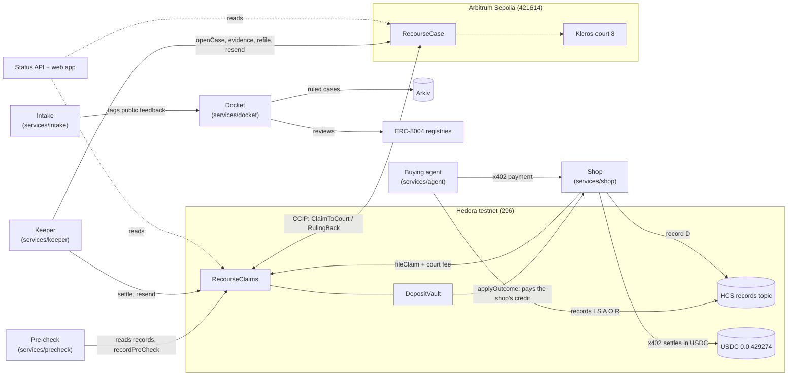
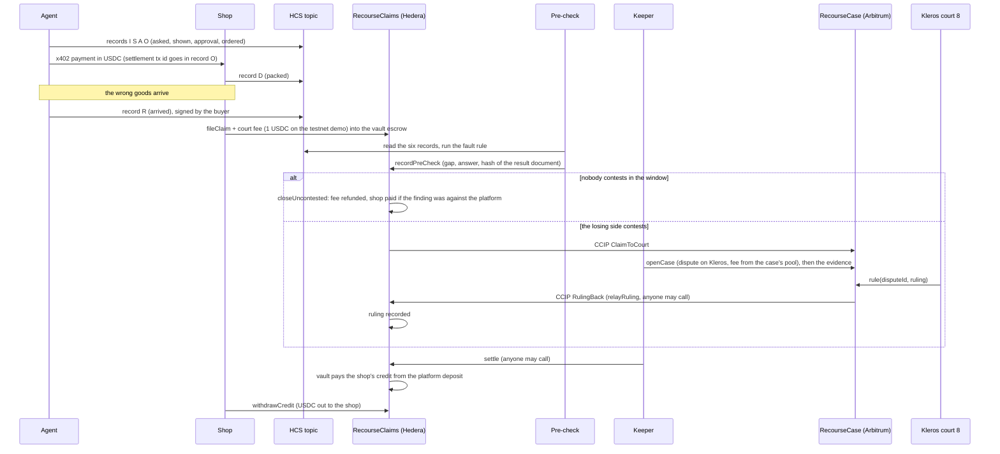

# Recourse

Recourse lets a shop recover money when an AI shopping agent buys the wrong thing.

An agent pays a shop over x402 on Hedera. Before it pays, it commits what it was asked, what it showed the buyer, the approval and the order to a Hedera Consensus Service topic; the shop commits what it packed. If the wrong goods arrive, the shop files a claim on Hedera and escrows a court fee. A rule-based pre-check compares the records, names the gap and the side at fault, and the losing side may contest. A contest crosses Chainlink CCIP to Arbitrum Sepolia, where a Kleros court rules. The ruling crosses back, and a USDC deposit posted by the agent company pays the shop. A docket on Arkiv publishes fault rates per agent company.

Built at ETHGlobal Mumbai, 5-7 Nov 2026. Testnets only. All shop and agent-company names are fictional.

> **Status: nothing is deployed yet.** The contracts, services and web app are written and tested locally. No contract has been deployed to a testnet, no account is funded, and no claim has been filed on a live network. See [What is live and what is not](#what-is-live-and-what-is-not). Every address and transaction section below is a placeholder until that changes.

## Contents

1. [Architecture](#architecture)
2. [One claim, end to end](#one-claim-end-to-end)
3. [How each technology is used](#how-each-technology-is-used)
4. [Repository layout](#repository-layout)
5. [Run the tests](#run-the-tests)
6. [Owner powers and spend paths](#owner-powers-and-spend-paths)
7. [What is live and what is not](#what-is-live-and-what-is-not)
8. [Deployed addresses and transactions](#deployed-addresses-and-transactions)
9. [Disclosures](#disclosures)

## Architecture



The two chains never share state. Everything either side needs from the other travels as a CCIP message of fixed layout ([interfaces](docs/spec/interfaces.md), section 8), and every receive path decodes defensively: a bad message is ignored with an event and never reverts, so one bad message cannot block a lane.

## One claim, end to end



1. **Records.** Six records per order, one HCS message each ([interfaces](docs/spec/interfaces.md), section 2): asked (I), shown (S), approval (A), ordered (O), packed (D), arrived (R). Each message holds the IPFS CID of a canonical document and its SHA-256. A record counts only if the HCS message payer is a known writer for that kind.
2. **Pre-check.** The fault rule is a fixed 12-step comparison over the six attributes (brand, size, colour, quantity, price, merchant): what was asked against what was shown, whether a change was approved, and what was shown against what was ordered, packed and received. It is a pure function in `packages/shared`; the pre-check service runs it, pins the result document and signs the finding. Anyone can re-run it from the public records.
3. **Contest.** The finding names a side. If the finding is against the platform, the platform contests; otherwise the shop. The window is closed at the end of the contest period.
4. **Court.** A contested claim goes to Arbitrum by CCIP. `RecourseCase` opens a Kleros dispute in court 8, with a three-way answer (agent company at fault, shop at fault, neither) and a published policy, and the keeper posts the evidence. The court's ruling comes back as a second CCIP message.
5. **Refused ruling.** A ruling of 0 (refused) is refiled once. A second 0 counts as a ruling equal to the pre-check answer.
6. **Payout.** The settlement table is in [interfaces](docs/spec/interfaces.md), section 10. In short: the loser pays the court fee; if the platform is at fault the shop gets its net loss plus a handling amount from the platform's deposit; if the shop is at fault it gets nothing and the fee stays with the pool. A claim that never reaches a ruling can be expired after a timeout, with the fee refunded.

## How each technology is used

| Technology | What it does here | Where in the code |
|---|---|---|
| **Hedera x402 payments** | The agent pays the shop with the x402 `exact` scheme on `hedera:testnet`, in USDC. The agent reads the price and `payTo` from the shop's 402 response; below its spend limit it pays without a human, above it a buyer approval is needed. A public facilitator is tried first, then a second public one, then a self-hosted one. The settlement transaction id goes into the "ordered" record. | `services/shop`, `services/agent` |
| **Hedera Consensus Service** | One records topic holds the six records of every order. The pre-check and the court evidence read the topic through the mirror node and accept only messages from the right payer. | `packages/records`, `services/precheck` |
| **HTS USDC** | Payments, the platform deposit, the court-fee escrow and the shop's payout are all USDC `0.0.429274`, used through its ERC-20 facade. The vault associates the token explicitly after deploy, and nothing moves before the mirror node shows the association. | `contracts/src/hedera`, `contracts/script/hedera` |
| **Chainlink CCIP, both ways** | `RecourseClaims` sends `ClaimToCourt` to `RecourseCase`; `RecourseCase` sends `RulingBack`. Each contract is its own receiver and sender, with V2 extra args, out-of-order execution on and full finality. Fees are paid in LINK (or HBAR on the Hedera side). Resend is open to anyone, capped in count and spacing, so a lost message costs a bounded amount of LINK. | `contracts/src/hedera/RecourseClaims.sol`, `contracts/src/arbitrum/RecourseCase.sol`, `contracts/src/shared` |
| **Kleros court on Arbitrum Sepolia** | `RecourseCase` creates the dispute on the live KlerosCore in court 8 (testnet), registers the dispute template, and receives the ruling through `rule`. The keeper pays the arbitration cost from the case's fee pool and posts the evidence. | `contracts/src/arbitrum`, `packages/court`, `services/keeper` |
| **Arkiv docket** | The docket service writes one de-identified `case` entity per ruled claim and a monthly count, from one writer wallet. The docket page reads them back and computes fault rates (Wilson 95% interval) in the browser. | `services/docket`, `arkiv/`, `apps/web/src/pages/Docket.tsx` |
| **ERC-8004 identity and reviews** | The platform, agent and shop register agent identities; after a case is written to the docket, the scheme wallet leaves a review in the reputation registry. A self-review is rejected by the registry, which is why the reviewer is a separate wallet. | `packages/shared/src/abi/erc8004.ts`, `services/docket/src/reviews.ts` |

Other parts: a status API and web app (case status, filing, docket), and an intake service whose only job is to tag public feedback text with an LLM. **No model decides money at any point at runtime.** Money moves only by the contracts' rules.

## Repository layout

| Path | What |
|---|---|
| `contracts/` | Foundry project: Hedera `RecourseClaims` and `DepositVault`, Arbitrum `RecourseCase`, shared types and codecs, CCIP ping contracts, deploy and wire scripts |
| `packages/shared` | Types, ids, hashing, codecs, the fault rule, status keys, address book, test vectors |
| `packages/court` | Kleros dispute template, court policy, evidence builder |
| `packages/records` | HCS record commits and reads, IPFS pinning |
| `packages/renderer` | The approval screen renderer |
| `services/shop`, `services/agent` | x402 seller and buyer |
| `services/precheck`, `services/keeper` | Fault rule runner; the machine that moves a claim between the chains |
| `services/docket`, `services/intake` | Arkiv publisher and ERC-8004 reviews; feedback tagger |
| `services/status-api`, `apps/web` | Read API and the web app |
| `arkiv/` | Arkiv usage notes: schema, query, friction, reach |
| `deployments/` | Addresses, ABIs and the wiring record per chain |
| `ops/` | Funding, wiring, service units, checks and the secret scan; `ops/workflows/` holds each area's AI-use notes |
| `docs/` | `spec/interfaces.md` (the contract between the parts), `decisions.md`, `checks.md`, `keys.md`, `ai-use.md` |

## Run the tests

Needs Node 22 or newer, pnpm, and Foundry. Close other heavy processes first; the full suite uses a few hundred MB.

```
pnpm install --frozen-lockfile
pnpm typecheck                       # every package, one at a time
pnpm test                            # TypeScript tests, one package at a time
cd contracts && forge test --jobs 1  # Solidity unit, fuzz and invariant tests
```

Local runs against throwaway anvil nodes (no testnet is touched):

```
pnpm --filter ./services/keeper test:anvil          # the keeper on two anvils with a local CCIP relay
bash contracts/script/hedera/hedera.sh rehearse <port>   # Hedera deploy-to-lock on one anvil
bash ops/wire/rehearse.sh                           # both deploys and every wiring step on two anvils
bash ops/units/install.sh --verify                  # validates the service unit files
```

The local runs use mock HTS, a mock arbitrator and the CCIP local simulator. They write only `*.local.json` files, which are git-ignored.

## Owner powers and spend paths

The deployer key owns all three contracts (two-step ownership transfer only). The owner can configure, never rule. Each contract has a one-way `lockConfig`; the table shows what is possible before and after it.

### `RecourseClaims` (Hedera)

| Power | Before lock | After lock |
|---|---|---|
| `setPeer` (the court contract), `setParams`, `setPreCheckSigner`, `setBridgeMode` (and the relayer) | yes | no |
| `sweepLink`, `sweepNative` (move this contract's LINK or HBAR out) | yes | no |
| `setExtraArgs` (CCIP gas for later sends) | yes | yes |
| `setFeeToken` (LINK or HBAR for CCIP fees) | yes | yes |
| `lockConfig` | once | |

The owner cannot change a recorded finding or ruling, file or settle a claim for a shop, or touch the vault's USDC. Trusted roles: the **pre-check signer** is the one trusted step (it signs the finding; anyone can re-run the check from the public records, and a wrong finding can be contested). The **ruling relayer** can record rulings only in the one-leg modes; in the default two-way mode that call is refused.

Spend paths: LINK or HBAR leaves for CCIP fees only, through `sendToCourt` and `resend` (permissionless, at most `maxSends` per claim and `resendGap` apart), and through `sweepLink` and `sweepNative` before the lock. No function accepts USDC.

### `DepositVault` (Hedera)

| Power | Before lock | After lock |
|---|---|---|
| `bindClaims`, `setParams` (top-up window, exit delay, minimum deposit) | yes | no |
| `setRequired(platform, amount)` (the deposit a platform must hold to be in good standing) | yes | yes |
| `lockConfig` | once | |

Spend paths: USDC leaves the vault only by `applyOutcome` (callable only by Claims, from its settle and close paths), by `withdrawCredit` (the shop or pool collecting its own credit), and by a platform's own `exit` after `requestExit` plus the exit delay, with no open claims. The owner cannot withdraw. `setRequired` can raise a platform's requirement, which can put it out of good standing and stop shops accepting its orders, so it is disclosed here as a live owner power.

### `RecourseCase` (Arbitrum Sepolia)

| Power | Before lock | After lock |
|---|---|---|
| `setPeer` (the Hedera claims contract), `setParams` (case deadline, open-case cap, resend gap, max sends), `setTrustedRelay` | yes | no |
| `sweepLink` | yes | no |
| `setExtraArgs` (CCIP gas for rulings; must be non-zero), `setPolicyURI` (must be an `/ipfs/` path), `setTemplateText` | yes | yes |
| `withdrawFeePool` (the team's arbitration money) | yes | yes |
| `lockConfig` | once | |

The owner cannot change or invent a ruling (only KlerosCore calls `rule`), cannot open a case without a stored claim, and cannot take ETH except through `withdrawFeePool`. `setTrustedRelay` is off by default; when set, that one address may submit a claim without CCIP, a disclosed trusted step. The template and policy changes affect only later cases.

Spend paths: ETH leaves through `openCase` and `refile` (exactly the live Kleros arbitration cost, at most two disputes per claim) and `withdrawFeePool` (owner only); ETH attached to `relayRuling` pays exactly the CCIP fee and the surplus goes back to the caller, or into the pool if the caller cannot take it. LINK leaves through `relayRuling` (permissionless, exactly the quoted fee, at most five sends per claim, 30 minutes apart, so the worst LINK loss per claim is five fees) and `sweepLink` before the lock. Plain ETH sends revert. `maxOpenCases` caps open disputes, and because opening and resending are permissionless, third parties can fill that cap.

### Keys

Ten roles, each with its own Foundry keystore kept outside the repo ([docs/keys.md](docs/keys.md) lists names and public addresses, never values). The deployer owns the contracts; `ops-hedera` and `ops-arb` run the keeper and top-ups; the others are service identities.

## What is live and what is not

| Part | State |
|---|---|
| Solidity contracts (Claims, Vault, Case) | Written. Unit, fuzz and invariant tests pass locally. DepositVault (`0.0.11329716`) and RecourseClaims (`0.0.11329717`) are deployed on Hedera testnet, on USDC `0.0.429274`, config not locked yet; see `deployments/hedera.json`. RecourseCase is **not deployed** on Arbitrum Sepolia yet. |
| Deploy and wiring scripts | Written and rehearsed on local anvils. The Hedera deploy, USDC association and parameter steps have run on testnet; the Arbitrum deploy and the wiring between the chains have not. |
| TypeScript services (shop, agent, pre-check, keeper, docket, intake, status API) | Written and tested against local chains and fakes. **Not running anywhere**; unit files are written but not installed. |
| Web app | Builds. Not hosted. |
| Funding | Small. Five Hedera roles hold a few HBAR from the faucet (at most 10 HBAR per address). No role holds Arbitrum Sepolia ETH or LINK yet. Testnet USDC has been requested for the platform, shop and agent and has not arrived yet. |
| CCIP lanes | Public lanes exist on both testnets; no message from this project has been sent. |
| Kleros dispute | No dispute has been created by this project. |
| Arkiv docket | Reads and writes work against a local store; no entity has been written to the Arkiv testnet. |
| ERC-8004 identities | Not registered. |
| Hedera testnet upgrade | Scheduled Fri 6 Nov 2026, 18:00-18:40 UTC; no Hedera sends are planned in that window. |

What is mocked, and only in tests and local runs: HTS and the PRNG system contract, the USDC token, the CCIP router (a local simulator with a relay that can drop and delay), and KlerosCore (a mock arbitrator that accepts a chosen ruling). Nothing in this repository fabricates a ruling, a payment or a transaction hash for display.

## Deployed addresses and transactions

Placeholder. Filled in from `deployments/` and `deployments/wiring.json` after the deploys; until then there are no addresses to link.

| Item | Chain | Address or id | Transaction | Explorer | Source verification |
|---|---|---|---|---|---|
| `DepositVault` | Hedera testnet | not deployed | not deployed | not deployed | not verified |
| `RecourseClaims` | Hedera testnet | not deployed | not deployed | not deployed | not verified |
| `RecourseCase` | Arbitrum Sepolia | not deployed | not deployed | not deployed | not verified |
| HCS records topic | Hedera testnet | not created | not created | not created | n/a |
| First settled x402 payment | Hedera testnet | not sent | not sent | not sent | n/a |
| First CCIP message each way | both | not sent | not sent | not sent | n/a |
| First Kleros case | Arbitrum Sepolia | not opened | not opened | not opened | n/a |
| Arkiv writer wallet | Arkiv testnet | `0x54E4545AFcf8960884A750320e70aFE16b2b3CaE` (address only, no entity written yet) | n/a | n/a | n/a |

## Disclosures

- Records are public by CID. Buyer fields inside them are salted, but the documents themselves are readable by anyone who has the CID.
- The shop attests its own net loss when it files (capped at the basket value); the pre-check signer is a trusted step; the docket is de-identified, and the scheme wallet that writes it also receives any unrefunded escrow.
- A platform with no deposit can still be claimed against; the shortfall is shown, not hidden.
- The court is Kleros testnet court 8, a test court with test jurors, not a production one.
- Most of this code was written by Claude agents directed by the team. See [docs/ai-use.md](docs/ai-use.md) for what was generated, by which model, and what people decided and reviewed.
- Licence: MIT ([LICENSE](LICENSE)).
