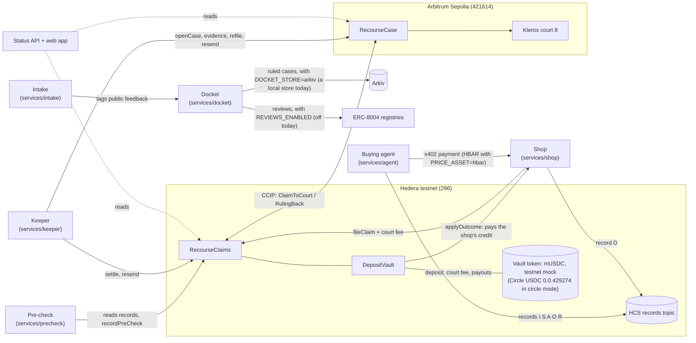
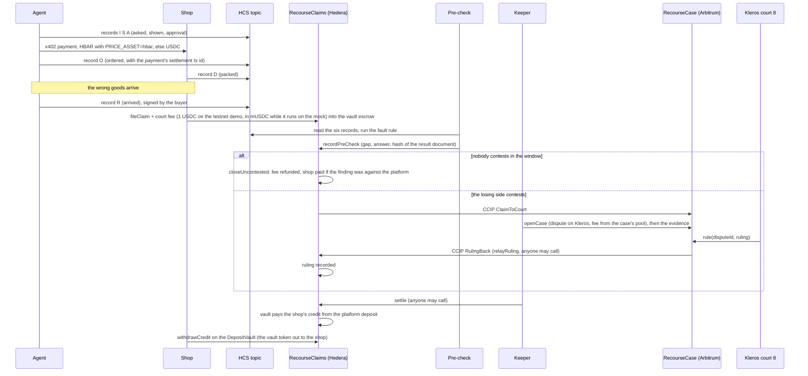

# Recourse

Recourse lets a shop recover money when an AI shopping agent buys the wrong thing.

An agent pays a shop over x402 (an HTTP payment protocol: the shop answers `402 Payment Required` with a price, and the client pays and asks again) on Hedera. Before it pays, it commits three records to a Hedera Consensus Service (HCS) topic: what it was asked, what it showed the buyer, and the approval. After the payment settles it commits a fourth, the ordered record, which carries the payment's transaction id; the shop commits what it packed. If the wrong goods arrive, the shop files a claim on Hedera and escrows a court fee. A rule-based pre-check compares the records, names the gap and the side at fault, and the losing side may contest. A contest crosses Chainlink CCIP (Cross-Chain Interoperability Protocol) to Arbitrum Sepolia, where a Kleros court rules. The ruling crosses back, and a deposit posted by the agent company pays the shop. On the testnet demo the deposit, the court fee and any payout are in mUSDC, a mock USDC token deployed for the demo, because Circle's testnet USDC faucet did not deliver. A docket service counts ruled cases per agent company and shop, for fault rates; it can publish them on Arkiv, but the running docket keeps them in a store on its own host, and nothing has been written to Arkiv yet.

Built at ETHGlobal Mumbai, 5-7 Nov 2026. Testnets only. All shop and agent-company names are fictional.

> **Status, 6 Nov 2026: running on testnets, configuration not locked.** The contracts are deployed on Hedera testnet and Arbitrum Sepolia and the services run on one host. Two claims have run to the end: one closed uncontested, and one was contested, ruled 3 ("neither side at fault") by Kleros court 8 (dispute 212), sent back to Hedera over CCIP and settled there on 6 Nov at 11:10 UTC. Both found nobody at fault, so no shop has yet been paid from a deposit. <!-- BUILD: payout case: one sentence and a link to its row in "Deployed addresses and transactions" once the shop has been paid from the deposit and has withdrawn. --> None of the three contracts is locked yet, so the deployer key can still change every setting, including ones that decide claims ([owner powers](#owner-powers-and-spend-paths)). See [What is live and what is not](#what-is-live-and-what-is-not).

## Contents

1. [Architecture](#architecture)
2. [One claim, end to end](#one-claim-end-to-end)
3. [How each technology is used](#how-each-technology-is-used)
4. [Repository layout](#repository-layout)
5. [Run the tests](#run-the-tests)
6. [Owner powers and spend paths](#owner-powers-and-spend-paths)
7. [What is live and what is not](#what-is-live-and-what-is-not)
8. [Deployed addresses and transactions](#deployed-addresses-and-transactions)
9. [Disclosures](#disclosures)

## Architecture



The two chains never share state. Everything either side needs from the other travels as a CCIP message of fixed layout ([interfaces](docs/spec/interfaces.md), section 8), and every receive path decodes defensively: a bad message is ignored with an event and never reverts, so one bad message cannot block a lane.

## One claim, end to end



1. **Records.** Six records per order, one HCS message each ([interfaces](docs/spec/interfaces.md), section 2): asked (I), shown (S), approval (A), ordered (O), packed (D), arrived (R). The agent writes asked, shown and approval before it pays and ordered after the payment settles (`services/agent/src/buy.ts`); the shop writes packed; the agent writes arrived, signed by the buyer. Each message holds the IPFS CID (content identifier) of a canonical document and its SHA-256. A record counts only if the HCS message payer is a known writer for that kind.
2. **Pre-check.** The fault rule is a fixed 12-step comparison over the six attributes (brand, size, colour, quantity, price, merchant): what was asked against what was shown, whether a change was approved, and what was shown against what was ordered, packed and received. It is a pure function in `packages/shared`; the pre-check service runs it, pins the result document and signs the finding. The hashes are public; anyone can check a document against them (the claim page's "Check a record" box hashes pasted text in the browser). The documents themselves are not on public IPFS yet: they sit in a content store on the demo host, and the status API serves them with each order's records (see [Disclosures](#disclosures)). The web app's "Check or file an order" page (`#/file`) re-runs the rule in the browser, on the records that API serves.
3. **Contest.** The finding names a side. If the finding is against the platform, the platform contests; otherwise the shop. The window is closed at the end of the contest period.
4. **Court.** A contested claim goes to Arbitrum by CCIP. `RecourseCase` opens a Kleros dispute in court 8, with a three-way answer (agent company at fault, shop at fault, neither) and a published policy, and the keeper posts the evidence. The court's ruling comes back as a second CCIP message.
5. **Refused ruling.** A ruling of 0 (refused) is refiled once. A second 0 counts as a ruling equal to the pre-check answer.
6. **Payout.** The settlement table is in [interfaces](docs/spec/interfaces.md), section 10. In short: the loser pays the court fee; if the platform is at fault the shop gets its net loss plus a handling amount from the platform's deposit; if the shop is at fault it gets nothing and the fee stays with the pool. A claim that never reaches a ruling can be expired after a timeout, with the fee refunded.

## How each technology is used

| Technology | What it does here | Where in the code |
|---|---|---|
| **Hedera x402 payments** | The agent pays the shop with the x402 `exact` scheme on `hedera:testnet`. On the testnet demo orders are priced and paid in HBAR, 1 HBAR per 1 USDC of list price, when `PRICE_ASSET=hbar`; unset or `usdc`, they are paid in USDC `0.0.429274`. Set it in the shared `~/.config/recourse/recourse.env`, which the shop unit, the agent commands and `ops/fund` all read, not in `shop.env`: a shop asking for HBAR from an agent that expects USDC is refused as `wrong_asset`. The agent reads the price and `payTo` from the shop's 402 response; below its spend limit it pays without a human, above it a buyer approval is needed. The spend limits are in USDC, and an HBAR amount is converted at that rate before it is compared. A public facilitator is tried first, then a second public one, then a self-hosted one. The settlement transaction id goes into the "ordered" record. | `services/shop`, `services/agent` |
| **Hedera Consensus Service** | One records topic holds the six records of every order. The pre-check and the court evidence read the topic through the mirror node and accept only messages from the right payer. | `packages/records`, `services/precheck` |
| **HTS USDC, or the testnet mock** | The platform deposit, the court-fee escrow and the shop's payout are all in the vault's token, which `deployments/hedera.json` records as `usdc.mode`; every reader takes it from that record, so one deployment never mixes tokens. In `circle` mode it is Circle's testnet USDC `0.0.429274`, used through its ERC-20 facade: the vault associates the token explicitly after deploy, and nothing moves before the mirror node shows the association. The current deployment is in `mock` mode, because Circle's faucet did not deliver: the token is `mUSDC`, a plain 6-decimal ERC-20 minted by the deployer, with no HTS token id and no mirror row, so the checks are `Vault.usdcAssociated()` and `Vault.usdc()` equal to the recorded address. With `PRICE_ASSET=hbar` the x402 order payments are in HBAR. | `contracts/src/hedera`, `contracts/script/hedera`, `contracts/src/testnet/MockUsdc.sol`, `packages/shared/src/vaultToken.ts`, `ops/lib/vault-token.sh` |
| **Chainlink CCIP, both ways** | `RecourseClaims` sends `ClaimToCourt` to `RecourseCase`; `RecourseCase` sends `RulingBack`. Each contract is its own receiver and sender, with V2 extra args, out-of-order execution on and full finality. Fees are paid in LINK (or HBAR on the Hedera side). Resend is open to anyone, capped in count and spacing, so a lost message costs a bounded amount of LINK. | `contracts/src/hedera/RecourseClaims.sol`, `contracts/src/arbitrum/RecourseCase.sol`, `contracts/src/shared` |
| **Kleros court on Arbitrum Sepolia** | `RecourseCase` creates the dispute on the live KlerosCore in court 8 (testnet), registers the dispute template, and receives the ruling through `rule`. The keeper pays the arbitration cost from the case's fee pool and posts the evidence. | `contracts/src/arbitrum`, `packages/court`, `services/keeper` |
| **Arkiv docket** | The docket service turns each ruled claim into one de-identified `case` row and keeps a monthly count per agent company and shop. With `DOCKET_STORE=arkiv` it writes them as Arkiv entities from one writer wallet; the running docket leaves `DOCKET_STORE` unset, so it keeps them in a local store in its own state folder (`local-store.jsonl`), and no entity has been written to the Arkiv testnet. The docket page reads Arkiv in the browser and computes fault rates (Wilson 95% interval) there; while the docket's store is local, the page says so and shows no rates. | `services/docket`, `arkiv/`, `apps/web/src/pages/Docket.tsx` |
| **ERC-8004 identity and reviews** | ERC-8004 is a set of on-chain registries for AI agents: identity, reputation and validation. The platform (the agent company) and the shop are registered in the identity registry, and the agent finds the shop's x402 endpoint from its registration (`SHOP_BASE_URL` is used only when that lookup fails, `services/agent/src/setup.ts`). With `REVIEWS_ENABLED` set, the docket's scheme wallet leaves a review in the reputation registry after each case it writes; it is off on the running docket, so no review has been written. A self-review is rejected by the registry, which is why the reviewer is a separate wallet. | `packages/shared/src/abi/erc8004.ts`, `services/docket/src/reviews.ts` |

Other parts: a status API and web app (case status, filing, docket), and an intake service whose only job is to tag public feedback text with an LLM. **No model decides money at any point at runtime.** Money moves only by the contracts' rules.

## Repository layout

| Path | What |
|---|---|
| `contracts/` | Foundry project: Hedera `RecourseClaims` and `DepositVault`, Arbitrum `RecourseCase`, shared types and codecs, CCIP ping contracts, deploy and wire scripts |
| `packages/shared` | Types, ids, hashing, codecs, the fault rule, status keys, address book, test vectors |
| `packages/court` | Kleros dispute template, court policy, evidence builder |
| `packages/records` | HCS record commits and reads, IPFS pinning |
| `packages/renderer` | The approval screen renderer |
| `services/shop`, `services/agent` | x402 seller and buyer |
| `services/precheck`, `services/keeper` | Fault rule runner; the machine that moves a claim between the chains |
| `services/docket`, `services/intake` | Arkiv publisher and ERC-8004 reviews; feedback tagger |
| `services/status-api`, `apps/web` | Read API and the web app |
| `arkiv/` | Arkiv usage notes: schema, query, friction, reach |
| `deployments/` | Addresses, ABIs and the wiring record per chain |
| `ops/` | Funding, wiring, service units, checks and the secret scan; `ops/workflows/` holds each area's AI-use notes |
| `docs/` | `spec/interfaces.md` (the contract between the parts), `decisions.md`, `checks.md`, `keys.md`, `ai-use.md` |

## Run the tests

Needs Node 22 or newer, pnpm, and Foundry. Close other heavy processes first; the full suite uses a few hundred MB.

```
pnpm install --frozen-lockfile
pnpm typecheck                       # every package, one at a time
pnpm test                            # TypeScript tests, one package at a time
cd contracts && forge test --jobs 1  # Solidity unit, fuzz and invariant tests
```

Local runs against throwaway anvil nodes (no testnet is touched):

```
pnpm --filter ./services/keeper test:anvil          # the keeper on two anvils with a local CCIP relay
bash contracts/script/hedera/hedera.sh rehearse <port>   # Hedera deploy-to-lock on one anvil
bash ops/wire/rehearse.sh                           # both deploys and every wiring step on two anvils
bash ops/units/install.sh --verify                  # validates the service unit files
```

The local runs use mock HTS, a mock arbitrator and the CCIP local simulator. They write only `*.local.json` files, which are git-ignored.

## Owner powers and spend paths

The deployer key owns all three contracts (two-step ownership transfer only). Each contract has a one-way `lockConfig`; the tables show what is possible before and after it. After the lock the owner can configure only the settings marked "yes" in the right-hand column, and none of them decides a claim. **Before the lock it can decide claims**: on `RecourseClaims` it can make itself the pre-check signer (`setPreCheckSigner`) and sign any finding, switch to a one-leg bridge mode with itself as the ruling relayer (`setBridgeMode`) and record any ruling, or point `setPeer` at a contract it controls and send a ruling back over CCIP; `settle`, which anyone may call, then pays from the platform's deposit. On 6 Nov 2026 none of the three contracts is locked (`configLocked()` and `locked()` read false), and the deployer keystore sits on the host that runs the services, including the two reached through public tunnels ([ops/units/README.md](ops/units/README.md#what-a-unit-can-see)). Until the lock, treat every claim as decided at the deployer's discretion.

### `RecourseClaims` (Hedera)

| Power | Before lock | After lock |
|---|---|---|
| `setPeer` (the court contract), `setParams`, `setPreCheckSigner`, `setBridgeMode` (and the relayer) | yes | no |
| `sweepLink`, `sweepNative` (move this contract's LINK or HBAR out) | yes | no |
| `setExtraArgs` (CCIP gas for later sends) | yes | yes |
| `setFeeToken` (LINK or HBAR for CCIP fees) | yes | yes |
| `lockConfig` | once | |

The owner cannot change a finding or ruling once it is recorded, file a claim for a shop, or move the vault's USDC itself; before the lock it can still choose who records the findings and rulings of claims not yet decided, as above. Trusted roles: the **pre-check signer** is the one trusted step (it signs the finding; the record hashes are public, so anyone can check a document against them and re-run the rule on documents that match, and a wrong finding can be contested). The **ruling relayer** can record rulings only in the one-leg modes; in the default two-way mode that call is refused, and only the owner can change the mode, before the lock.

Spend paths: LINK or HBAR leaves for CCIP fees only, through `sendToCourt` and `resend` (permissionless, at most `maxSends` per claim and `resendGap` apart), and through `sweepLink` and `sweepNative` before the lock. No function accepts USDC.

### `DepositVault` (Hedera)

| Power | Before lock | After lock |
|---|---|---|
| `bindClaims`, `setParams` (top-up window, exit delay, minimum deposit) | yes | no |
| `setRequired(platform, amount)` (the deposit a platform must hold to be in good standing) | yes | yes |
| `lockConfig` | once | |

Spend paths: USDC leaves the vault only by `applyOutcome` (callable only by Claims, from its settle and close paths), by `withdrawCredit` (the shop or pool collecting its own credit), and by a platform's own `exit` after `requestExit` plus the exit delay, with no open claims. The owner cannot withdraw. `setRequired` can raise a platform's requirement, which can put it out of good standing and stop shops accepting its orders, so it is disclosed here as a live owner power.

### `RecourseCase` (Arbitrum Sepolia)

| Power | Before lock | After lock |
|---|---|---|
| `setPeer` (the Hedera claims contract), `setParams` (case deadline, open-case cap, resend gap, max sends), `setTrustedRelay` | yes | no |
| `sweepLink` | yes | no |
| `setExtraArgs` (CCIP gas for rulings; must be non-zero), `setPolicyURI` (must be an `/ipfs/` path), `setTemplateText` | yes | yes |
| `withdrawFeePool` (the team's arbitration money) | yes | yes |
| `lockConfig` | once | |

The owner cannot change or invent a ruling (only KlerosCore calls `rule`), cannot open a case without a stored claim, and cannot take ETH except through `withdrawFeePool`. `setTrustedRelay` is off by default; when set, that one address may submit a claim without CCIP, a disclosed trusted step. The template and policy changes affect only later cases.

Spend paths: ETH leaves through `openCase` and `refile` (exactly the live Kleros arbitration cost, at most two disputes per claim) and `withdrawFeePool` (owner only); ETH attached to `relayRuling` pays exactly the CCIP fee and the surplus goes back to the caller, or into the pool if the caller cannot take it. LINK leaves through `relayRuling` (permissionless, exactly the quoted fee, at most five sends per claim, 30 minutes apart, so the worst LINK loss per claim is five fees) and `sweepLink` before the lock. Plain ETH sends revert. `maxOpenCases` caps open disputes, and because opening and resending are permissionless, third parties can fill that cap.

### Keys

Ten roles, each with its own Foundry keystore kept outside the repo ([docs/keys.md](docs/keys.md) lists names and public addresses, never values). The deployer owns the contracts; `ops-hedera` and `ops-arb` run the keeper and top-ups; the others are service identities.

## What is live and what is not

| Part | State |
|---|---|
| Solidity contracts (Claims, Vault, Case) | Written. Unit, fuzz and invariant tests pass locally. DepositVault (`0.0.11336129`) and RecourseClaims (`0.0.11336130`) are deployed on Hedera testnet on a testnet mock USDC (`mUSDC`), because Circle's testnet USDC faucet did not deliver; config not locked yet; see `deployments/hedera.json` (`usdc.mode` is `mock`, with the mock's address). The first deployment (`0.0.11329716`, `0.0.11329717`, on Circle USDC `0.0.429274`) is retired and listed in `deployments/retired.json`. RecourseCase (`0xd7f11FA06A97a45a6Af03c71d7eB3219C1a703B8`) is deployed on Arbitrum Sepolia; see `deployments/arbitrum.json`. |
| Deploy and wiring scripts | Written and rehearsed on local anvils. The Hedera deploy, USDC association and parameter steps have run on testnet, and so has the Arbitrum deploy. `deployments/wiring.json` lists the wiring steps run through the scripts; its first Hedera rows were sent to the retired claims contract and are marked `retired`. The replacement claims contract was wired outside the scripts (its peer, its LINK, and RecourseCase repointed to it in `0x0bf1a1f62c9a62066128d31de5a26e637b2616044d4c93ddee6b5bc3d4ad1e8f`, see `deployments/retired.json`). |
| TypeScript services (shop, pre-check, keeper, docket, intake, status API) | Running on one host against Hedera testnet and Arbitrum Sepolia, as systemd user units ([ops/units/README.md](ops/units/README.md)). The buying agent has no long-running service; it places one order per run from the command line. |
| Web app | Built and served from the same host by `recourse-web`, reached through a Cloudflare quick tunnel. A quick tunnel's name changes on every restart, so no URL is pinned here; `bash ops/units/ctl.sh urls` prints the current one. |
| Orders and claims | Two x402 payments have settled on Hedera testnet in HBAR through the x402.org facilitator (listed below). The second paid for a demo order, which the shop then claimed against. The pre-check answered 3 ("neither": the agent's mandate had approved the size change the claim was about), nobody contested within the window, and the keeper closed the claim; the 1 mUSDC court fee went back to the shop as credit. A second claim (`0x392d6f13…7c3c50`, a second demo order) was also pre-checked 3; the shop contested it, it went to Arbitrum over CCIP and became Kleros dispute 212, and the court ruled 3 ("neither"). The ruling came back over CCIP and the keeper settled the claim on Hedera on 6 Nov at 11:10 UTC: nothing was owed, and the shop's 1 mUSDC court fee was kept by the pool. The first claim's 1 mUSDC credit was withdrawn by the shop. |
| Funding | Small. The Hedera roles hold a few HBAR each from the faucet (at most 10 HBAR per address). On Arbitrum Sepolia the deployer and `ops-arb` hold test ETH and RecourseCase's fee pool, funded with 0.01 ETH for Kleros fees, held 0.00919 ETH after dispute 212; RecourseCase holds no LINK, so the keeper pays the ruling's CCIP fee in ETH from `ops-arb`. The claims contract holds test LINK for CCIP fees (`ops/wire/12-set-fee-token.sh` switches it between LINK and HBAR). Circle testnet USDC was requested for the platform, shop and agent and never arrived; the vault's `mUSDC` is minted by the deployer, the mock's owner. With orders paid in HBAR (`PRICE_ASSET=hbar`) the agent needs no USDC; its HBAR floor is then 8 (`ops/fund/lib.sh`). |
| CCIP lanes | Public lanes exist on both testnets and the peers are set both ways. Two messages so far, both for claim `0x392d…` and both executed: `ClaimToCourt` to Arbitrum (sent 09:07 UTC on 6 Nov, executed within a minute) and `RulingBack` to Hedera (sent 10:51 UTC, executed 11:10 UTC). |
| Kleros dispute | Dispute 212 in court 8, opened by RecourseCase on 6 Nov at 09:08 UTC with the order records as evidence, ruled 3 ("neither") at 10:43 UTC, and executed at 10:51 UTC. |
| Arkiv docket | The docket runs on its local store (`DOCKET_STORE` unset): it holds the ruled case of dispute 212 and that month's count there, and no entity has been written to the Arkiv testnet. |
| ERC-8004 identities | Registered in the identity registry `0x8004A818BFB912233c491871b3d84c89A494BD9e` on Hedera testnet: agent 149 is the platform ("Parcel Minds"), agent 150 the shop ("Halden Supply"). No review has been written: reviews are off on the running docket (`REVIEWS_ENABLED` defaults to off). |
| Source verification | Not done for any contract yet. |
| Hedera testnet upgrade | Fri 6 Nov 2026, 17:50-18:55 UTC: Hedera testnet is paused, and its public JSON-RPC relay (`testnet.hashio.io`) has answered 502 since about 16:50 UTC. No Hedera sends are planned in that window; the services' Hedera reads fail until it ends and resume on their own. |

<!-- BUILD: redeployed contracts: update the "Solidity contracts" row above (new Hedera ids and addresses, lock state) and the "Source verification" row (verified on HashScan and Arbiscan, with links). -->
<!-- BUILD: remove or update the "Hedera testnet upgrade" row once the upgrade is over. -->

What is mocked in tests and local runs, which deploy their own mocks: HTS and the PRNG system contract, the USDC token, the CCIP router (a local simulator with a relay that can drop and delay), and KlerosCore (a mock arbitrator that accepts a chosen ruling). One mock is live: the testnet demo's current Hedera deployment runs on a testnet mock USDC (`mUSDC`, "Mock USD Coin (testnet)", 6 decimals, minted only by its owner) because Circle's testnet USDC faucet did not deliver to our accounts. It is not Circle's token and is worth nothing; the status API and the web app label its amounts "mUSDC (testnet mock)". The first deployment, on Circle USDC, is retired and listed in `deployments/retired.json`. Order payments (x402) are in HBAR and never touch the vault token. Nothing in this repository fabricates a ruling, a payment or a transaction hash for display.

## Deployed addresses and transactions

Taken from `deployments/`, `deployments/wiring.json`, `packages/records/h0-ids.json`, the Hedera mirror node and the status API's chain reads (`GET /claims/<id>`). All testnet.

| Item | Chain | Address or id | Transaction | Explorer | Source verification |
|---|---|---|---|---|---|
| `DepositVault` | Hedera testnet | `0.0.11336129` (`0xA22fB188b49eddecc4f9DE22607e70E1d07Aea2e`) | `0x05923a8a3abcf2988ff7b1c3ea29bfedcf0f8c6df18a71e23b314c4f26bce11d` | [HashScan](https://hashscan.io/testnet/contract/0.0.11336129) | not verified |
| `RecourseClaims` | Hedera testnet | `0.0.11336130` (`0xc4d457991eE42438EA433773e491ba8F2B27dDee`) | `0x1196cbc22c60db8cfe6443ba51bae809a4a8c7e106545e739071ea3f488a1d53` | [HashScan](https://hashscan.io/testnet/contract/0.0.11336130) | not verified |
| `MockUsdc` (`mUSDC`, the vault token) | Hedera testnet | `0x6D6fb82e82E525B9c30619189EA8aF17117C3c73` | `0x14005c3a5027eb101c99528d990ee1b2ff6d53f6de60a3aee196fe34cb6801e0` | [HashScan](https://hashscan.io/testnet/contract/0x6D6fb82e82E525B9c30619189EA8aF17117C3c73) | not verified |
| `RecourseCase` | Arbitrum Sepolia | `0xd7f11FA06A97a45a6Af03c71d7eB3219C1a703B8` | `0x21695fedbc3d8d91c15c651eb8ae8ed747adf356182038b437b64633b00e6492` | [Arbiscan](https://sepolia.arbiscan.io/address/0xd7f11FA06A97a45a6Af03c71d7eB3219C1a703B8) | not verified |
| HCS records topic | Hedera testnet | `0.0.11335218` | `0.0.11329551@1793945456.221613303` | [HashScan](https://hashscan.io/testnet/topic/0.0.11335218) | n/a |
| ERC-8004 agents 149 (platform), 150 (shop) | Hedera testnet | registry `0x8004A818BFB912233c491871b3d84c89A494BD9e` | `0xea5d875c0d3ac84055636ee4f082a8bfe3acb495885e5baf32f2e8ef8c5eaa64`, `0xd7e03c68f1240111c45d7af8d5a581614ce234a3a0a29ae93c8b91bc7ae5314a` | [HashScan](https://hashscan.io/testnet/contract/0x8004A818BFB912233c491871b3d84c89A494BD9e) | n/a |
| First settled x402 payment (0.1 HBAR, agent `0.0.11329682` to shop `0.0.11329680`) | Hedera testnet | n/a | `0.0.9185802@1793949477.114377745` | [HashScan](https://hashscan.io/testnet/transaction/1793949483.409917104) | n/a |
| First demo order payment (1.5 HBAR, same accounts) | Hedera testnet | order `0x1bf80d52b5b114f4318d40259c3bc2990db86f8e82a5101abafb337f4f3ad802` | `0.0.9185802@1793954349.706075765` | [HashScan](https://hashscan.io/testnet/transaction/1793954357.635329575) | n/a |
| First claim: filed, pre-checked, closed uncontested | Hedera testnet | claim `0x9cd704684c56a0ba1ff17ba9765d7c1e8521e78a3d0a4bbe7935d5a2a87e412c` | `0x8b1c0ace74283adc097c8f557b4adffaac2dcab530467d58b92a50612297c789`, `0x2c8d558a26cd071e74cac125179fc51b592c83f9bd3af96db2a7bf69b37a1deb`, `0x243c3b5403d70a87dc78713ab337e97386c2ea37683fcb87245b68d58f3e9665` | [HashScan](https://hashscan.io/testnet/contract/0.0.11336130) | n/a |
| First claim taken to court: filed, pre-checked, contested, sent | Hedera testnet | claim `0x392d6f13cdf5fe1ca93289d143e51b511f333de3d6d1769c72ddd0039c7f3c50` | `0xb0486c1e1cec26ef8910dceb092888e00ad2f798590531f36fe56ceb99679776`, `0x22454f7e9df75d5052a39a8c7cfa0a74c3696ebaf9f6e75d6adcd40621990810`, `0xd4b1351daa9bf82b3bc6bf086b80e7117e7e84cda66ea20e1db3d33f6453fec3`, `0xcf5236a69f8c8a0d8c4d537993692e41bdd4194ba2b2027eaea0037bebe933c4` | [HashScan](https://hashscan.io/testnet/contract/0.0.11336130) | n/a |
| First CCIP message to Arbitrum (`ClaimToCourt`) | Hedera to Arbitrum Sepolia | message `0x6631dc70a8a954c4e442cb8104af8d5c45b2117724d6deea096e9a8d6bc60adc` | sent in `0xcf5236a6…e933c4`, received in `0x27555711edfb76427d17b791aec8bc25c6ab7e70a33e19588aa9e662da3bd7db` | [CCIP Explorer](https://ccip.chain.link/msg/0x6631dc70a8a954c4e442cb8104af8d5c45b2117724d6deea096e9a8d6bc60adc) | n/a |
| First Kleros case | Arbitrum Sepolia | dispute 212, court 8 (template 194) | opened `0x993c49af2b77ed0710c5e3f5d17efc9789e80333a488ca3f894058ae6eb83a42`, evidence `0x6c97c6c8ff46997e118d7531410861324bc6f98dc92c3f01fb4223abdf4f9959`, ruling executed `0xeebfe2fea6267ecc3acbdc30a6ab74981ed653b4efba12c0abae86f06e41d417` | [Kleros](https://v2-testnet.kleros.builders/#/cases/212/overview) | n/a |
| First CCIP message to Hedera (`RulingBack`) | Arbitrum Sepolia to Hedera | message `0xbc0bb5f319c9045d70576b7a906c84b149a10c6de6638eda8eb4148e29d52ff3` | sent in `0x6d471236aac5149728e96e977fc492ff2b5536fefeb8c545bf121e29a8f13c0d` (fee in ETH), received in `0x33363440caab6fe0719e806d4bf2ce132673208d7e3280ca4d426d96dc3f15c3` | [CCIP Explorer](https://ccip.chain.link/msg/0xbc0bb5f319c9045d70576b7a906c84b149a10c6de6638eda8eb4148e29d52ff3) | n/a |
| First court case settled: ruling 3 applied, nothing owed, court fee kept by the pool | Hedera testnet | claim `0x392d6f13cdf5fe1ca93289d143e51b511f333de3d6d1769c72ddd0039c7f3c50` | `0x502db49f52f56bb2e1f014277139ccf140344186e6a5f257a9c59d7b9d90bd40` | [HashScan](https://hashscan.io/testnet/contract/0.0.11336130) | n/a |
| First credit withdrawn (claim `0x9cd7…412c`'s 1 mUSDC, to the shop) | Hedera testnet | vault `0.0.11336129` | `0x082d0148c6773a8c6f0b4e62db4a9cb28d88e6d41285380728a428cb3b57f050` | [HashScan](https://hashscan.io/testnet/contract/0.0.11336129) | n/a |
| Arkiv writer wallet | Arkiv testnet | `0x54E4545AFcf8960884A750320e70aFE16b2b3CaE` (address only, no entity written yet) | n/a | n/a | n/a |

<!-- BUILD: payout case: add its rows inside the table above (x402 payment, the six records, fileClaim, recordPreCheck, closeUncontested or settle, withdrawCredit), each with its hash and explorer link. -->
<!-- BUILD: redeployed contracts: add the new DepositVault, RecourseClaims, MockUsdc and RecourseCase rows inside the table above (address, deploy tx, explorer), keep the old rows marked retired, and fill the "Source verification" column with the HashScan and Arbiscan verification links. -->
<!-- BUILD: the two test runs side by side: add a "### Test runs on testnet" heading here and one table with a column per run (the same command against the old and the redeployed contracts: command, order id, claim id, each step's tx hash, result). -->

## Disclosures

- Record documents: the hashes are public; anyone can check a document against them. Each record's CID and SHA-256 are on the public HCS topic, but the documents are not on public IPFS: Filebase pinning (`IPFS_PIN_API_KEY`, `IPFS_PIN_API_SECRET`, `IPFS_PIN_BUCKET`) is not configured, so every service pins to a content store on the demo host instead (`IPFS_PIN_API_URL=file://…`, one file per CID in `~/.local/state/recourse/ipfs`, `packages/records/src/ipfs.ts`). The CIDs are the ones a public pin of the same bytes would get. Off the host, the documents can be read only through the status API (`GET /orders/<orderId>/records` returns each record's document after checking it against its hash), which the web app shows, and only while the host is up. Buyer fields inside them are salted; anyone who can read a document can read the rest of it.
- The shop attests its own net loss when it files (capped at the basket value); the pre-check signer is a trusted step; the docket is de-identified, and the scheme wallet that writes it also receives any unrefunded escrow.
- A platform with no deposit can still be claimed against; the shortfall is shown, not hidden.
- The court is Kleros testnet court 8, a test court with test jurors, not a production one.
- Most of this code was written by Claude agents directed by the team. See [docs/ai-use.md](docs/ai-use.md) for what was generated, by which model, and what people decided and reviewed.
- Licence: MIT ([LICENSE](LICENSE)).
